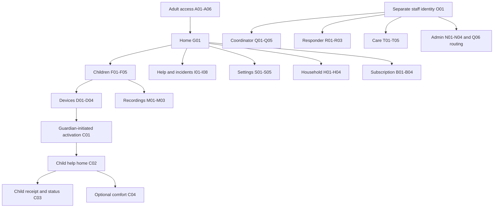

# Life alert - Flutter screen architecture and designer handoff

**Draft 0.1 | October 15, 2026 | Design planning, not mobile implementation or client sign-off.**

## 1. Scope and authority

This NEW design handoff derives from [PRD.md](PRD.md) and [BACKEND.md](BACKEND.md). Preserve those baselines. A bounded Django backend foundation already exists with migrations, scoped API services and simulated integrations. A minimal Flutter structure preview is now authorized at frontend/mobile: shared placeholders, role-aware route guards and disabled integration boundaries. No finished mobile designs, real auth or live actions exist. Backend implementation remains on hold pending separate human go-ahead.

Confirmed surfaces: parent/authorized caregiver Flutter app and a restricted linked-child Flutter experience for future Android/iOS. Staff access, coordinator, crew, temporary-care and administration are separate operations surfaces; whether they use staff Flutter apps or a web console is TBD. They are not tabs in the consumer app. Shared device/package strategy is pending.

M1 = recommended first mobile DESIGN pass; M2 = later/expanded mobile design. O = later operations design, platform TBD. These are design priorities, not promised implementation dates. Planned flows in M1 still need contracts/client validation before development. All screen names/routes are proposed and stable within this draft.

Capability tags: F = foundation core contract exists (not a finished screen or production integration); M = mixed foundation support and planned gaps; P = planned/not yet supported. Every screen has states; variants do not multiply screen counts.

## 2. Navigation and role boundaries

Adult shell: Home (G01), Children (F01), Incidents (I05), Settings (S01); Updates (G03) is later, preferably an inbox action instead of another permanent tab. Show active incident access persistently. Subscription/readiness are contextual destinations, not emergency blockers after acceptance.

Linked-child shell: C02 help home, C03 current request/status and optional C04 comfort experience. C01 activation occurs before use through guardian setup. No adult login, parent approval or inaccessible confirmation at incident time. Parent administration must remain behind a distinct authenticated adult boundary; do not rely on an undisclosed gesture as security.

Guardian manages own household. Invited caregivers get only explicit child/action grants; their precise invite/authority system is planned. Being an emergency contact does not imply guardianship, placement consent or collection authority. Recheck access on deep links, account changes and revoked devices.



## 3. Rules that designs must preserve

- Parent/child help runs parent notifications, organizational response and configured EMS work in parallel. Parent acknowledgement is never approval. A coordinator explicitly owns the incident and works on a solution.
- New paid request IDs require current entitlement. Identical retries replay accepted results; accepted care continues after expiry through resolution. Network or coverage loss never cancels the subscription. Ordinary supported emergency calling is separate and never implies connection or dispatch from a tap alone.
- Route by child/incident location, including capture time/accuracy. Never silently use a remote parent's location. Missing/stale location and saved-address fallback are explicit.
- Current foundation allows one open incident per child. Another request records follow-up/review and its location, not independent response. Designers must surface that limitation, not silently show a second dispatched emergency. Free-text family follow-up/rerouting is planned.
- Cancellation is a REQUEST. Coordinator reviews/reconciles any crew, EMS and care work. A local cancellation state is not evidence that external EMS was cancelled. No care placement is required to resolve, but assistance, verified handover/disposition, EMS outcome and follow-up must be recorded.
- Recordings have comfort and instruction audiences, optionally both by explicit permission. Children never see responder-only material. Playback is not notification delivery.
- No guaranteed ambulance, housing, arrival or 24/7 surveillance/staffing. Proposed 5-10 minute mobilization target requires client staffing/coverage and milestone validation; never hardcode an ETA.

## 4. Critical interaction contracts

### Help initiation and uncertainty

On help action, preserve a request UUID and original normalized payload. Show local sending immediately, server receipt only after durable acceptance, and unconfirmed delivery after timeout/offline. Do not auto-create a new request ID on every retry. Reconnected old queued actions need an approved relevance-review policy before operational escalation. The future app must not replay stale emergency actions invisibly. Request expiry, queue lifetime and escalation ownership remain decisions.

A child must not complete a required reading, timing puzzle, parent PIN or multi-step confirmation to request help. Validate the interaction with actual individual needs and assistive technology; optional accidental-tap handling is a cancellation request after initiation, not a hidden response gate. Keep audio optional and provide meaningful non-audio alternatives.

### Evidence-based copy

| UI fact | Copy direction | Not sufficient evidence |
| --- | --- | --- |
| No server confirmation | Delivery not confirmed; use separate supported calling if needed | A local tap or spinning animation |
| Durable acceptance | Your request was received | Locally queued action |
| Actual crew offer | We are contacting a response team | Generic notification/provider receipt |
| Coordinator owner recorded | A coordinator is working on your request | Alert sent/read alone |
| Crew accepts | A response team has accepted your request | Offer delivered |
| Crew records en-route | Your response team is on the way | Assignment acceptance |
| EMS uncertain | Emergency handoff status is not confirmed | Provider acknowledgement |
| Follow-up mapped to open incident | New information needs coordinator review; separate response unconfirmed | Existing incident's crew status |
| Cancellation requested | Cancellation requested; response may continue pending review | Button press or locally closed view |

Status pages label last update/source and show stale/offline explicitly. Live refresh/push is not yet implemented; prototypes must distinguish simulated evidence.

### Temporary care and authority

Coordinator checks suitability/capacity, verifies authority/consent, reserves and assigns qualified staff; approved transport and intake lead into accountable care handovers. Release requires verified recipient identity and authority. I07/I08 show only appropriately authorized family tasks; staff T screens are separate. No capacity/authority leads to coordinator alternatives, not a false reservation. Structured identity, transport, consent and detailed staff workflows are planned; current APIs store reference assertions and a few states only.

## 5. Components, sheets and variants - not extra screens

| ID | Reusable boundary | Variants / safety semantics |
| --- | --- | --- |
| UI-01 | Accessible help control | Individual non-reader/motor/sensory adaptation; not color/audio-only; no mandatory approval barrier |
| UI-02 | Receipt/status banner and milestone track | Local, unconfirmed, received, claimed owner, offered, assigned, en-route, arrived, unknown/stale; evidence labels |
| UI-03 | Child selector + care summary | Authorized scope only; child context remains visible during adult help |
| UI-04 | Location evidence card and permission sheet | Live fix/time/accuracy, denied/missing/stale, labeled saved fallback, remote-parent warning, coverage unknown |
| UI-05 | Audio recorder/player + text alternative | Purpose badges, permission/mic/upload/playback variants, interruption, no staff material in child context |
| UI-06 | Cancellation-request sheet | Accessible action; reason if suitable; request recorded versus coordinator-approved external reconciliation |
| UI-07 | Supported ordinary emergency-call handoff | Billing-independent; invoke supported OS pathway; unsupported/no cellular capabilities explicit; no claim of connection/dispatch |
| UI-08 | Contact/address edit sheet | Validation, role versus authority, save conflict/offline; does not need standalone routes for every CRUD action |
| UI-09 | Revoke device / unsaved changes / sign-out sheets | Explicit impact, protected adult boundary, unknown result handling; never deletes incidents |
| UI-10 | Identity/consent evidence panel | Mask sensitive data, verified authority/source/validity, conflict/review states, no automatic release |
| UI-11 | Global async state pattern | Loading, empty, error, retry, offline/stale, access revoked, unknown outcome; keep actions idempotent |
| UI-12 | Plan/billing provider result + document viewer | Approved external/native billing boundary; success/pending/failure/cancel; no invented prices/vendor |

## 6. Exhaustive purposeful screen inventory

The complete screen list is in [SCREEN-LIST.md](SCREEN-LIST.md); every named state maps to its screen in [SCREEN-STATE-CHECKLIST.csv](SCREEN-STATE-CHECKLIST.csv). These are integral companions. Shared states are not additional product screens; all still need design coverage. Every entry below identifies entry/exit, required state variants, permissions, accessibility, priority and traceability. Normal back navigation returns to the last permitted route; revoked/expired scope removes protected content/back-stack data. State variants and sheets above are not separate counted screens.

### A01 - Welcome + service scope

| Field | Specification |
| --- | --- |
| Surface / phase | Shared access / M1 |
| Proposed route | `/welcome` |
| Purpose | Explain service and begin adult access. |
| Key content / actions | Read service boundaries; sign in; create family; access supported ordinary emergency calling. |
| Entry | Cold adult launch / signed-out route |
| Exit | A02 sign-in or A03 registration; linked child mode bypasses this screen. |
| Important states | Loading configuration; unavailable coverage info; offline; returning device mode. |
| Permissions | Adult/public; never an incident-time child login gate. |
| Accessibility | Readable errors, screen-reader labels, autofill and scalable text. Preserve safe return destination. |
| PRD trace | PRD §§2,4; READY-01 |
| Current API boundary | P: production onboarding; service claims need client review. |

### A02 - Adult sign in

| Field | Specification |
| --- | --- |
| Surface / phase | Shared access / M1 |
| Proposed route | `/access/sign-in` |
| Purpose | Authenticate guardian or invited caregiver. |
| Key content / actions | Sign in using approved future identity method; recover access; return to allowed deep link. |
| Entry | A01 / expired adult session / caregiver invitation |
| Exit | G01 home; H04 invitation acceptance; A05 recovery. |
| Important states | Submitting; invalid credentials; locked/rate-limited; offline; session expired. |
| Permissions | Adult/public; never an incident-time child login gate. |
| Accessibility | Readable errors, screen-reader labels, autofill and scalable text. Preserve safe return destination. |
| PRD trace | FAM-01; PRD §8 |
| Current API boundary | M: local session/CSRF exists; native auth, MFA and token renewal not final. |

### A03 - Create family account

| Field | Specification |
| --- | --- |
| Surface / phase | Shared access / M1 |
| Proposed route | `/access/register` |
| Purpose | Create an adult account and household. |
| Key content / actions | Enter minimum account/household fields; review required notices; submit registration. |
| Entry | A01 / A02 |
| Exit | A04 verification then G02 readiness. |
| Important states | Validation; duplicate account; submitting; failed/unknown result; offline. |
| Permissions | Adult/public; never an incident-time child login gate. |
| Accessibility | Readable errors, screen-reader labels, autofill and scalable text. Preserve safe return destination. |
| PRD trace | FAM-01, FAM-02; PRD §8 |
| Current API boundary | M: local username registration exists; production consent/contact verification planned. |

### A04 - Verify contact

| Field | Specification |
| --- | --- |
| Surface / phase | Shared access / M1 |
| Proposed route | `/access/verify` |
| Purpose | Verify approved account contact without asserting legal authority. |
| Key content / actions | Enter link/code; resend under approved policy; correct contact. |
| Entry | A03 / unverified account / changed contact |
| Exit | G02 readiness or return to account setting. |
| Important states | Pending; invalid/expired code; throttled; verified; offline. |
| Permissions | Adult/public; never an incident-time child login gate. |
| Accessibility | Readable errors, screen-reader labels, autofill and scalable text. Preserve safe return destination. |
| PRD trace | FAM-02; PRD §8 |
| Current API boundary | P: channel, verification provider and expiry rules undecided. |

### A05 - Recover access

| Field | Specification |
| --- | --- |
| Surface / phase | Shared access / M1 |
| Proposed route | `/access/recover` |
| Purpose | Start secure adult account recovery. |
| Key content / actions | Provide approved account identifier; request recovery; receive non-enumerating feedback. |
| Entry | A02 / support |
| Exit | A06 recovery completion or A02. |
| Important states | Generic submitted result; offline; throttled; recovery unavailable. |
| Permissions | Adult/public; never an incident-time child login gate. |
| Accessibility | Readable errors, screen-reader labels, autofill and scalable text. Preserve safe return destination. |
| PRD trace | FAM-01; PRD §8 |
| Current API boundary | P: recovery service not implemented. |

### A06 - Complete recovery

| Field | Specification |
| --- | --- |
| Surface / phase | Shared access / M1 |
| Proposed route | `/access/recover/complete` |
| Purpose | Finish verified recovery and return to adult access. |
| Key content / actions | Use verified recovery token; set new credential through approved identity flow; review session impact. |
| Entry | Approved recovery deep link |
| Exit | A02 then authorized destination. |
| Important states | Expired/used token; invalid credential; success; interrupted; offline. |
| Permissions | Adult/public; never an incident-time child login gate. |
| Accessibility | Readable errors, screen-reader labels, autofill and scalable text. Preserve safe return destination. |
| PRD trace | FAM-01; PRD §8 |
| Current API boundary | P: identity provider and credential/session rules pending; never child help gate. |

### G01 - Family home

| Field | Specification |
| --- | --- |
| Surface / phase | Parent / caregiver / M1 |
| Proposed route | `/home` |
| Purpose | Orient the adult and foreground active care. |
| Key content / actions | Select authorized child; open active incident; request help; view readiness/subscription indicators. |
| Entry | Authenticated adult / safe notification deep link |
| Exit | I01 request; I03 active incident; F01 children; G02 readiness. |
| Important states | No child; active incident; unknown/stale status; inactive entitlement; offline. |
| Permissions | Guardian owns household; invited caregiver gets explicit child/action grants. Invitation/authority verification is planned, not implied by emergency-contact status. |
| Accessibility | Large touch targets, logical focus, text scaling and non-color status cues. Do not expose another household via links/back stack. |
| PRD trace | READY-01; INC-03, INC-04; SUB-02 |
| Current API boundary | M: core records exist; aggregate dashboard/push entry planned. |

### G02 - Readiness checklist

| Field | Specification |
| --- | --- |
| Surface / phase | Parent / caregiver / M1 |
| Proposed route | `/readiness` |
| Purpose | Explain separately what is ready and missing. |
| Key content / actions | Review profile, contacts, device, subscription and coverage; complete one item at a time. |
| Entry | Registration / G01 / child overview |
| Exit | F03 profile; D02 link; B01 subscription; return G01. |
| Important states | Incomplete; saved; unavailable coverage; denied permissions; offline; entitlement unknown. |
| Permissions | Guardian owns household; invited caregiver gets explicit child/action grants. Invitation/authority verification is planned, not implied by emergency-contact status. |
| Accessibility | Large touch targets, logical focus, text scaling and non-color status cues. Do not expose another household via links/back stack. |
| PRD trace | READY-01; DEV-01; LOC-01; SUB-01 |
| Current API boundary | M: source records exist; readiness aggregation and verified coverage-hours model planned. |

### G03 - Updates inbox

| Field | Specification |
| --- | --- |
| Surface / phase | Parent / caregiver / M2 |
| Proposed route | `/updates` |
| Purpose | Collect permitted family updates without treating delivery as ownership. |
| Key content / actions | Open incident/placement update; mark read; review delivery/acknowledgement context. |
| Entry | Home tab / permitted notification |
| Exit | I03 incident; I07 placement; return G01. |
| Important states | Empty; loading; failed refresh; stale/offline cache; permission lost. |
| Permissions | Guardian owns household; invited caregiver gets explicit child/action grants. Invitation/authority verification is planned, not implied by emergency-contact status. |
| Accessibility | Large touch targets, logical focus, text scaling and non-color status cues. Do not expose another household via links/back stack. |
| PRD trace | INC-03, INC-04; PRD §8 |
| Current API boundary | P: inbox, real delivery and push not implemented; receipt simulation is not a live inbox. |

### H01 - Household + caregiver access

| Field | Specification |
| --- | --- |
| Surface / phase | Parent / caregiver / M2 |
| Proposed route | `/household` |
| Purpose | Show household membership and authorized scope. |
| Key content / actions | Review members and pending invites; open person scope; invite if guardian. |
| Entry | G01 / S01 settings |
| Exit | H02 invitation; H03 rights/authority; return home. |
| Important states | No invites; pending; accepted; revoked; authority unresolved; offline. |
| Permissions | Guardian owns household; invited caregiver gets explicit child/action grants. Invitation/authority verification is planned, not implied by emergency-contact status. |
| Accessibility | Large touch targets, logical focus, text scaling and non-color status cues. Do not expose another household via links/back stack. |
| PRD trace | FAM-01, FAM-02 |
| Current API boundary | M: guardian membership exists; invitations and scoped caregiver grants planned. |

### H02 - Invite caregiver

| Field | Specification |
| --- | --- |
| Surface / phase | Parent / caregiver / M2 |
| Proposed route | `/household/invite` |
| Purpose | Propose explicit limited caregiver access. |
| Key content / actions | Choose person/contact, child scope and allowed actions; review invitation before sending. |
| Entry | H01 guardian action |
| Exit | H01 pending invite or H03 scope review. |
| Important states | Invalid contact; pending send; duplicate; expiry; failure; offline. |
| Permissions | Guardian owns household; invited caregiver gets explicit child/action grants. Invitation/authority verification is planned, not implied by emergency-contact status. |
| Accessibility | Large touch targets, logical focus, text scaling and non-color status cues. Do not expose another household via links/back stack. |
| PRD trace | FAM-02; AT-13 |
| Current API boundary | P: invite delivery/grants unsupported; no assumed consent or guardianship. |

### H03 - Caregiver scope + authority

| Field | Specification |
| --- | --- |
| Surface / phase | Parent / caregiver / M2 |
| Proposed route | `/household/members/:memberId` |
| Purpose | Review permissions separately from legal care/release authority. |
| Key content / actions | Inspect child/action grants; request verified authority review; revoke access using a reviewed flow. |
| Entry | H01 / consent or release review |
| Exit | H01; I08 authorization when relevant. |
| Important states | Pending verification; valid/expired/revoked grants; contested authority; saving; offline. |
| Permissions | Guardian owns household; invited caregiver gets explicit child/action grants. Invitation/authority verification is planned, not implied by emergency-contact status. |
| Accessibility | Large touch targets, logical focus, text scaling and non-color status cues. Do not expose another household via links/back stack. |
| PRD trace | FAM-02; ACC-03, ACC-06 |
| Current API boundary | P: current foundation has guardian relations only; authority/grant lifecycle planned. |

### H04 - Accept invitation

| Field | Specification |
| --- | --- |
| Surface / phase | Parent / caregiver / M2 |
| Proposed route | `/household/invitations/:inviteId` |
| Purpose | Accept only the offered scope after adult authentication. |
| Key content / actions | Review inviter, children and allowed actions; accept/decline; do not broaden grants. |
| Entry | Invitation deep link via A02/A04 if needed |
| Exit | Scoped G01 or H01; denied link returns safe access screen. |
| Important states | Expired; already used; revoked; wrong account; accepted; offline. |
| Permissions | Guardian owns household; invited caregiver gets explicit child/action grants. Invitation/authority verification is planned, not implied by emergency-contact status. |
| Accessibility | Large touch targets, logical focus, text scaling and non-color status cues. Do not expose another household via links/back stack. |
| PRD trace | FAM-02; AT-13 |
| Current API boundary | P: invitation and scoped caregiver endpoints planned. |

### F01 - Children directory

| Field | Specification |
| --- | --- |
| Surface / phase | Parent / caregiver / M1 |
| Proposed route | `/children` |
| Purpose | Select a child within authorized household scope. |
| Key content / actions | Open child; add child if guardian; show active incident/readiness summary. |
| Entry | Home children tab |
| Exit | F02 overview; F03 new profile; I03 active incident. |
| Important states | Empty; loading; read denied; failed refresh; offline/stale. |
| Permissions | Guardian owns household; invited caregiver gets explicit child/action grants. Invitation/authority verification is planned, not implied by emergency-contact status. |
| Accessibility | Large touch targets, logical focus, text scaling and non-color status cues. Do not expose another household via links/back stack. |
| PRD trace | FAM-01; CARE-01; AT-13 |
| Current API boundary | F: guardian child list/create/read/update exists; scoped invite rights planned. |

### F02 - Child overview

| Field | Specification |
| --- | --- |
| Surface / phase | Parent / caregiver / M1 |
| Proposed route | `/children/:childId` |
| Purpose | Summarize the individual care plan and readiness. |
| Key content / actions | Review communication/support/calming summary; open profile, contacts, places, devices, recordings and help. |
| Entry | F01 / selected child home |
| Exit | F03/F04/F05; D01; M01; I01. |
| Important states | Incomplete profile; latest-update uncertainty; active incident; access revoked; offline. |
| Permissions | Guardian owns household; invited caregiver gets explicit child/action grants. Invitation/authority verification is planned, not implied by emergency-contact status. |
| Accessibility | Large touch targets, logical focus, text scaling and non-color status cues. Do not expose another household via links/back stack. |
| PRD trace | CARE-01, CARE-02; READY-01 |
| Current API boundary | M: latest profile exists; version snapshots, readiness summary and detailed update history planned. |

### F03 - Care profile editor

| Field | Specification |
| --- | --- |
| Surface / phase | Parent / caregiver / M1 |
| Proposed route | `/children/:childId/edit` |
| Purpose | Create/edit individual support and communication information. |
| Key content / actions | Record strengths, communication, support needs, calming preferences and relevant instructions; review before saving. |
| Entry | F01 new / F02 edit |
| Exit | F02 saved summary or discard-changes sheet. |
| Important states | Validation; unsaved; saving; conflict; failed/unknown save; offline. |
| Permissions | Guardian owns household; invited caregiver gets explicit child/action grants. Invitation/authority verification is planned, not implied by emergency-contact status. |
| Accessibility | Large touch targets, logical focus, text scaling and non-color status cues. Do not expose another household via links/back stack. |
| PRD trace | CARE-01, CARE-02; AT-13 |
| Current API boundary | M: core text fields/update exist; extra fields, version/concurrency policy need design/API agreement. |

### F04 - Emergency contacts

| Field | Specification |
| --- | --- |
| Surface / phase | Parent / caregiver / M1 |
| Proposed route | `/children/:childId/contacts` |
| Purpose | Keep relevant contacts visible without granting collection authority. |
| Key content / actions | View contact order/details; add/edit via contact sheet; distinguish role and authority status. |
| Entry | F02 / help preparation |
| Exit | Contact edit sheet; F02; I01 when requesting help. |
| Important states | Empty; incomplete contact; saving; delivery channel unverified; offline. |
| Permissions | Guardian owns household; invited caregiver gets explicit child/action grants. Invitation/authority verification is planned, not implied by emergency-contact status. |
| Accessibility | Large touch targets, logical focus, text scaling and non-color status cues. Do not expose another household via links/back stack. |
| PRD trace | CARE-01; FAM-02; ACC-06 |
| Current API boundary | M: list/create/read exists; edit/order/verification and authority workflow planned. |

### F05 - Saved places + location

| Field | Specification |
| --- | --- |
| Surface / phase | Parent / caregiver / M1 |
| Proposed route | `/children/:childId/places` |
| Purpose | Manage labeled address fallbacks and location expectations. |
| Key content / actions | Review/add saved address; name place; show fallback status and permission guidance. |
| Entry | F02 / I01 location review |
| Exit | Address editor sheet; I01; F02. |
| Important states | No address; stale/denied location; inaccurate fix; fallback; unsupported area; offline. |
| Permissions | Guardian owns household; invited caregiver gets explicit child/action grants. Invitation/authority verification is planned, not implied by emergency-contact status. |
| Accessibility | Large touch targets, logical focus, text scaling and non-color status cues. Do not expose another household via links/back stack. |
| PRD trace | LOC-01, LOC-02; AT-04, AT-05 |
| Current API boundary | M: one saved address/core location exists; multi-place CRUD/maps/geocoding planned. |

### D01 - Linked devices

| Field | Specification |
| --- | --- |
| Surface / phase | Parent / caregiver / M1 |
| Proposed route | `/children/:childId/devices` |
| Purpose | Review device access for this child. |
| Key content / actions | List links, limited status and revoked devices; start secure linking; open device detail. |
| Entry | F02 / G02 |
| Exit | D02 link; D03 detail. |
| Important states | No devices; linking pending; revoked; status unknown/stale; offline. |
| Permissions | Guardian owns household; invited caregiver gets explicit child/action grants. Invitation/authority verification is planned, not implied by emergency-contact status. |
| Accessibility | Large touch targets, logical focus, text scaling and non-color status cues. Do not expose another household via links/back stack. |
| PRD trace | DEV-01, DEV-02; AT-15 |
| Current API boundary | M: device list/create/revoke exists; live heartbeat/capabilities and pairing planned. |

### D02 - Link a child device

| Field | Specification |
| --- | --- |
| Surface / phase | Parent / caregiver / M1 |
| Proposed route | `/children/:childId/devices/link` |
| Purpose | Establish scoped child access before an incident. |
| Key content / actions | Guide approved secure pairing; explain child scope; complete setup on target device. |
| Entry | D01 / G02 with guardian authentication |
| Exit | C01 target activation; D03 success/detail. |
| Important states | Pairing pending; expired/used challenge; wrong child; interrupted; offline. |
| Permissions | Guardian owns household; invited caregiver gets explicit child/action grants. Invitation/authority verification is planned, not implied by emergency-contact status. |
| Accessibility | Large touch targets, logical focus, text scaling and non-color status cues. Do not expose another household via links/back stack. |
| PRD trace | DEV-01, DEV-02 |
| Current API boundary | M: one-time returned credential exists; secure native pairing UX/protocol still planned. Never expose raw permanent tokens in designs. |

### D03 - Device access detail

| Field | Specification |
| --- | --- |
| Surface / phase | Parent / caregiver / M1 |
| Proposed route | `/children/:childId/devices/:deviceId` |
| Purpose | Manage one linked device and recover lost access. |
| Key content / actions | View linked child and access status; revoke with explicit impact sheet; replace link. |
| Entry | D01 / pairing completion |
| Exit | D01; D02 replacement; D04 child settings. |
| Important states | Active; revoked; revoking; failed/unknown request; offline. |
| Permissions | Guardian owns household; invited caregiver gets explicit child/action grants. Invitation/authority verification is planned, not implied by emergency-contact status. |
| Accessibility | Large touch targets, logical focus, text scaling and non-color status cues. Do not expose another household via links/back stack. |
| PRD trace | DEV-01; AT-15 |
| Current API boundary | M: revocation exists; richer status and replacement/rotation policy planned. |

### D04 - Child experience preferences

| Field | Specification |
| --- | --- |
| Surface / phase | Parent / caregiver / M1 |
| Proposed route | `/children/:childId/experience` |
| Purpose | Prepare individual child interaction choices behind adult access. |
| Key content / actions | Select accessible feedback, comfort content and interaction adaptations validated with the child. |
| Entry | F02 / D03 in adult context |
| Exit | Preview simulation component then D03/F02; do not send real alerts. |
| Important states | Unset; saving; incompatible device feature; offline; permission denied. |
| Permissions | Guardian owns household; invited caregiver gets explicit child/action grants. Invitation/authority verification is planned, not implied by emergency-contact status. |
| Accessibility | Large touch targets, logical focus, text scaling and non-color status cues. Do not expose another household via links/back stack. |
| PRD trace | CARE-01; DEV-02; PRD §§4,14 |
| Current API boundary | P: child UI preferences/capabilities API planned; no diagnosis-based presets or secret bypass gestures. |

### M01 - Care recordings library

| Field | Specification |
| --- | --- |
| Surface / phase | Parent / caregiver / M1 |
| Proposed route | `/children/:childId/recordings` |
| Purpose | Organize recordings by purpose and audience. |
| Key content / actions | Filter comfort/instructions/both; open item; create recording; view text alternative. |
| Entry | F02 / D04 |
| Exit | M02 create; M03 detail; authorized player component. |
| Important states | Empty; loading; upload pending; unauthorized audience; offline/unavailable audio. |
| Permissions | Guardian owns household; invited caregiver gets explicit child/action grants. Invitation/authority verification is planned, not implied by emergency-contact status. |
| Accessibility | Large touch targets, logical focus, text scaling and non-color status cues. Do not expose another household via links/back stack. |
| PRD trace | MEDIA-01, MEDIA-02; AT-14 |
| Current API boundary | F: purpose metadata, text and authorized audio retrieval exist; mobile recorder/format work planned. |

### M02 - Create a recording

| Field | Specification |
| --- | --- |
| Surface / phase | Parent / caregiver / M1 |
| Proposed route | `/children/:childId/recordings/new` |
| Purpose | Capture or select safe care audio and label its purpose. |
| Key content / actions | Request microphone when needed; record/review; provide text; select audiences; upload with progress. |
| Entry | M01 |
| Exit | M03 after save; discard sheet returns M01. |
| Important states | Mic denied; recording/paused; interrupted; upload retry/unknown; offline; invalid file. |
| Permissions | Guardian owns household; invited caregiver gets explicit child/action grants. Invitation/authority verification is planned, not implied by emergency-contact status. |
| Accessibility | Large touch targets, logical focus, text scaling and non-color status cues. Do not expose another household via links/back stack. |
| PRD trace | MEDIA-01, MEDIA-02 |
| Current API boundary | M: protected PCM WAV upload exists; native capture/conversion, offline queue and storage policy planned. |

### M03 - Recording details + audience

| Field | Specification |
| --- | --- |
| Surface / phase | Parent / caregiver / M1 |
| Proposed route | `/children/:childId/recordings/:mediaId` |
| Purpose | Review playback, text and explicit audience permissions. |
| Key content / actions | Play/pause via shared player; edit title/text; change comfort/instruction/both access; review sharing impact. |
| Entry | M01 / saved M02 |
| Exit | Player sheet; M01; D04 selection. |
| Important states | Loading; unavailable/revoked; permission changed; saving; playback interrupted. |
| Permissions | Guardian owns household; invited caregiver gets explicit child/action grants. Invitation/authority verification is planned, not implied by emergency-contact status. |
| Accessibility | Large touch targets, logical focus, text scaling and non-color status cues. Do not expose another household via links/back stack. |
| PRD trace | MEDIA-01, MEDIA-02; AT-14 |
| Current API boundary | M: metadata/audience updates and private stream exist; deletion/retention request policy planned. |

### B01 - Subscription + entitlement

| Field | Specification |
| --- | --- |
| Surface / phase | Parent / caregiver / M1 |
| Proposed route | `/subscription` |
| Purpose | Show paid eligibility separately from coverage/connectivity. |
| Key content / actions | View status/effective dates and existing incident continuity; renew or manage through approved billing flow. |
| Entry | Home / readiness / inactive-request result |
| Exit | B02 plan review; B03 billing; I03 accepted incident. |
| Important states | Active; expired; inactive; unknown; renewal pending; offline/out-of-area independent. |
| Permissions | Guardian owns household; invited caregiver gets explicit child/action grants. Invitation/authority verification is planned, not implied by emergency-contact status. |
| Accessibility | Large touch targets, logical focus, text scaling and non-color status cues. Do not expose another household via links/back stack. |
| PRD trace | SUB-01, SUB-02; AT-08, AT-09, AT-10 |
| Current API boundary | M: local ledger/incident evidence exist; family entitlement read API and real billing planned. |

### B02 - Plan + renewal review

| Field | Specification |
| --- | --- |
| Surface / phase | Parent / caregiver / M1 |
| Proposed route | `/subscription/plans` |
| Purpose | Explain client-approved paid services before purchase/renewal. |
| Key content / actions | Review configured terms, service limits and pricing when supplied; select plan; continue. |
| Entry | B01 / readiness |
| Exit | B03 approved billing handoff; B01. |
| Important states | Pricing unavailable; no eligible plan; terms pending; offline. |
| Permissions | Guardian owns household; invited caregiver gets explicit child/action grants. Invitation/authority verification is planned, not implied by emergency-contact status. |
| Accessibility | Large touch targets, logical focus, text scaling and non-color status cues. Do not expose another household via links/back stack. |
| PRD trace | SUB-01; PRD §§6,12 |
| Current API boundary | P: no pricing, vendor, plan catalogue or payment eligibility decided; placeholders are explicit. |

### B03 - Billing handoff + result

| Field | Specification |
| --- | --- |
| Surface / phase | Parent / caregiver / M1 |
| Proposed route | `/subscription/billing` |
| Purpose | Manage purchase/renewal through an approved future billing boundary. |
| Key content / actions | Launch approved platform/provider payment flow; reconcile success/pending/failure; manage cancellation/refund request per policy. |
| Entry | B02 / B01 manage action / provider return |
| Exit | B01 after verified entitlement; support if unresolved. |
| Important states | Cancelled checkout; failed; pending; verified success; duplicate return; unknown/offline. |
| Permissions | Guardian owns household; invited caregiver gets explicit child/action grants. Invitation/authority verification is planned, not implied by emergency-contact status. |
| Accessibility | Large touch targets, logical focus, text scaling and non-color status cues. Do not expose another household via links/back stack. |
| PRD trace | SUB-01; AT-08, AT-10 |
| Current API boundary | P: no real processing. Payment acknowledgement alone does not activate entitlement; platform/payment approach pending. |

### B04 - Billing history + documents

| Field | Specification |
| --- | --- |
| Surface / phase | Parent / caregiver / M2 |
| Proposed route | `/subscription/history` |
| Purpose | Review authorized household billing records and support references. |
| Key content / actions | List verified transactions/documents; open invoice; request billing support. |
| Entry | B01 |
| Exit | Document viewer component; S05 support; B01. |
| Important states | Empty; unavailable invoice; pending/refund state; access denied; offline. |
| Permissions | Guardian owns household; invited caregiver gets explicit child/action grants. Invitation/authority verification is planned, not implied by emergency-contact status. |
| Accessibility | Large touch targets, logical focus, text scaling and non-color status cues. Do not expose another household via links/back stack. |
| PRD trace | SUB-01; PRD §§6,8 |
| Current API boundary | P: billing records/export/refund API planned; do not design fabricated prices or invoices. |

### I01 - Parent request context

| Field | Specification |
| --- | --- |
| Surface / phase | Parent / caregiver / M1 |
| Proposed route | `/help/new` |
| Purpose | Identify child and incident location with minimal friction. |
| Key content / actions | Choose authorized child; review child/incident location and labeled fallback; initiate paid organizational help or separate ordinary calling. |
| Entry | G01 / F02 |
| Exit | I02 submit feedback; I03 existing incident/follow-up result; B01 inactive entitlement. |
| Important states | Location denied/missing/stale/inaccurate; remote parent; coverage unsupported; entitlement unknown/expired; offline. |
| Permissions | Guardian owns household; invited caregiver gets explicit child/action grants. Invitation/authority verification is planned, not implied by emergency-contact status. |
| Accessibility | Large touch targets, logical focus, text scaling and non-color status cues. Do not expose another household via links/back stack. |
| PRD trace | INC-01; LOC-01, LOC-02; SUB-02; AT-01, AT-04, AT-05 |
| Current API boundary | M: help/location/entitlement contract exists; native permission/routing map UX planned. Do not default to remote parent location. |

### I02 - Request delivery feedback

| Field | Specification |
| --- | --- |
| Surface / phase | Parent / caregiver / M1 |
| Proposed route | `/help/requests/:requestId` |
| Purpose | Distinguish local tap, pending transmission and durable server receipt. |
| Key content / actions | Show sending/unconfirmed/received; retry identical request safely; open incident; separate ordinary calling. |
| Entry | I01 / safe retry/deep link |
| Exit | I03 accepted incident; follow-up review message; I01 only through safe recovery. |
| Important states | Sending; server received; timeout unknown; offline; invalid/revoked access; coverage/entitlement error. |
| Permissions | Guardian owns household; invited caregiver gets explicit child/action grants. Invitation/authority verification is planned, not implied by emergency-contact status. |
| Accessibility | Large touch targets, logical focus, text scaling and non-color status cues. Do not expose another household via links/back stack. |
| PRD trace | INC-01, INC-02; AT-02, AT-03, AT-19, AT-20 |
| Current API boundary | M: atomic acceptance/replay exists; device persistence/offline queue/relevance review planned. |

### I03 - Live incident

| Field | Specification |
| --- | --- |
| Surface / phase | Parent / caregiver / M1 |
| Proposed route | `/incidents/:incidentId/live` |
| Purpose | Show known response facts without a false promise. |
| Key content / actions | View coordinator/crew/EMS/placement milestones and last update; request cancellation; add follow-up; inspect care updates. |
| Entry | I02 / active card / authorized update |
| Exit | I04 follow-up; I07 placement; cancellation sheet; I06 after resolution. |
| Important states | Received; owner unclaimed/claimed; offered/accepted/en-route; provider unknown; stale/offline; expiry during accepted care. |
| Permissions | Guardian owns household; invited caregiver gets explicit child/action grants. Invitation/authority verification is planned, not implied by emergency-contact status. |
| Accessibility | Large touch targets, logical focus, text scaling and non-color status cues. Do not expose another household via links/back stack. |
| PRD trace | INC-03 through INC-09; SUB-01; AT-06, AT-10, AT-11, AT-18 |
| Current API boundary | M: scoped statuses and cancellation request exist; push/live refresh, outcome detail and richer caregiver updates planned. |

### I04 - Additional help + follow-up

| Field | Specification |
| --- | --- |
| Surface / phase | Parent / caregiver / M1 |
| Proposed route | `/incidents/:incidentId/follow-up` |
| Purpose | Provide new emergency information without pretending separate dispatch. |
| Key content / actions | Describe or route new context through approved future input; preserve original request result; explicitly request review. |
| Entry | I03 / another help action while incident open |
| Exit | I03 with followup_requires_review; ordinary calling if appropriate. |
| Important states | Review pending; entitlement expired for new paid request; sending/unconfirmed; different location; offline. |
| Permissions | Guardian owns household; invited caregiver gets explicit child/action grants. Invitation/authority verification is planned, not implied by emergency-contact status. |
| Accessibility | Large touch targets, logical focus, text scaling and non-color status cues. Do not expose another household via links/back stack. |
| PRD trace | INC-02, INC-09; AT-02; PRD §14 |
| Current API boundary | M: new request ID records location/review flag for one open incident. Free-text family follow-up and independent simultaneous incidents not supported yet. |

### I05 - Incident history

| Field | Specification |
| --- | --- |
| Surface / phase | Parent / caregiver / M1 |
| Proposed route | `/incidents/history` |
| Purpose | Find permitted past and current incidents. |
| Key content / actions | List/filter own child incidents; open live or completed record; show missing history honestly. |
| Entry | Home activity/history tab |
| Exit | I03 open incident; I06 past detail. |
| Important states | Empty; loading; partial history; access revoked; offline/stale. |
| Permissions | Guardian owns household; invited caregiver gets explicit child/action grants. Invitation/authority verification is planned, not implied by emergency-contact status. |
| Accessibility | Large touch targets, logical focus, text scaling and non-color status cues. Do not expose another household via links/back stack. |
| PRD trace | INC-08, INC-09; PRD §8 |
| Current API boundary | M: scoped incident list exists; advanced filtering/archive and retention policy planned. |

### I06 - Incident outcome detail

| Field | Specification |
| --- | --- |
| Surface / phase | Parent / caregiver / M1 |
| Proposed route | `/incidents/:incidentId` |
| Purpose | Explain recorded assistance and handover after response. |
| Key content / actions | Review known timeline, outcome and approved follow-up; open placement history; contact support. |
| Entry | I05 / resolved I03 |
| Exit | I07 placement; S05 support; I05. |
| Important states | Resolved; cancelled after review; incomplete/uncertain evidence; retention unavailable; offline. |
| Permissions | Guardian owns household; invited caregiver gets explicit child/action grants. Invitation/authority verification is planned, not implied by emergency-contact status. |
| Accessibility | Large touch targets, logical focus, text scaling and non-color status cues. Do not expose another household via links/back stack. |
| PRD trace | INC-07, INC-08; ACC-06; PRD §14 closure |
| Current API boundary | M: outcome stored; family-readable outcome/timeline/handover API incomplete. Do not infer external cancellation. |

### I07 - Temporary-care updates

| Field | Specification |
| --- | --- |
| Surface / phase | Parent / caregiver / M1 |
| Proposed route | `/incidents/:incidentId/care` |
| Purpose | Show whether placement is considered, confirmed or active. |
| Key content / actions | View suitability/capacity review, authorized location/status and handover updates; respond to permitted authorization tasks. |
| Entry | I03 / I06 / approved update |
| Exit | I08 authorization; live incident/outcome. |
| Important states | No place; authority unresolved; reserved; intake; active care; released; unknown/offline. |
| Permissions | Guardian owns household; invited caregiver gets explicit child/action grants. Invitation/authority verification is planned, not implied by emergency-contact status. |
| Accessibility | Large touch targets, logical focus, text scaling and non-color status cues. Do not expose another household via links/back stack. |
| PRD trace | ACC-01 through ACC-07; AT-16, AT-17 |
| Current API boundary | M: placement states exist; detailed parent-facing placement/status/staff/transport APIs planned. |

### I08 - Care authorization + recipient check

| Field | Specification |
| --- | --- |
| Surface / phase | Parent / caregiver / M1 |
| Proposed route | `/incidents/:incidentId/care/authorization` |
| Purpose | Support protected consent/authorized-recipient verification. |
| Key content / actions | Review placement/release request, authority basis and permitted identity steps; confirm only within verified authority or ask coordinator. |
| Entry | I07 / authorized care task; adult reauthentication where justified |
| Exit | I07 pending/verified result; no automatic release. |
| Important states | Wrong person; authority missing/expired; contested consent; verification pending/failed; offline. |
| Permissions | Guardian owns household; invited caregiver gets explicit child/action grants. Invitation/authority verification is planned, not implied by emergency-contact status. |
| Accessibility | Large touch targets, logical focus, text scaling and non-color status cues. Do not expose another household via links/back stack. |
| PRD trace | FAM-02; ACC-03, ACC-06; AT-17 |
| Current API boundary | P: structured consent/identity verification not implemented; emergency-contact status is insufficient. |

### S01 - Settings + service information

| Field | Specification |
| --- | --- |
| Surface / phase | Parent / caregiver / M1 |
| Proposed route | `/settings` |
| Purpose | Find adult account, privacy, notification and support controls. |
| Key content / actions | Open account/security/privacy/preferences/support; view service terms/version; sign out adults. |
| Entry | Home settings tab |
| Exit | S02-S05; A01 after sign-out; preserve separately linked child mode. |
| Important states | Loading settings; offline; update unavailable; session expired. |
| Permissions | Guardian owns household; invited caregiver gets explicit child/action grants. Invitation/authority verification is planned, not implied by emergency-contact status. |
| Accessibility | Large touch targets, logical focus, text scaling and non-color status cues. Do not expose another household via links/back stack. |
| PRD trace | FAM-01; PRD §8 |
| Current API boundary | M: adult logout exists; aggregated preferences/legal content/configuration planned. |

### S02 - Account + security

| Field | Specification |
| --- | --- |
| Surface / phase | Parent / caregiver / M2 |
| Proposed route | `/settings/account` |
| Purpose | Manage adult identity and access safely. |
| Key content / actions | Review contact/security sessions; request contact/password change through approved flow; view guardian verification status. |
| Entry | S01 |
| Exit | A04 verify change; identity-provider flow; S01. |
| Important states | Reauthentication; unverified change; pending; expired session; offline. |
| Permissions | Guardian owns household; invited caregiver gets explicit child/action grants. Invitation/authority verification is planned, not implied by emergency-contact status. |
| Accessibility | Large touch targets, logical focus, text scaling and non-color status cues. Do not expose another household via links/back stack. |
| PRD trace | FAM-01, FAM-02; PRD §8 |
| Current API boundary | P: account edits, production sessions/MFA/verification planned; no sensitive credential changes implemented by this document. |

### S03 - Privacy + data requests

| Field | Specification |
| --- | --- |
| Surface / phase | Parent / caregiver / M2 |
| Proposed route | `/settings/privacy` |
| Purpose | Explain access/retention and request reviewed data actions. |
| Key content / actions | Read purpose/retention notices; request export/correction/deletion or account closure; view request status. |
| Entry | S01 |
| Exit | Request sheet/status variant; S05 support; S01. |
| Important states | Pending request; legal hold/review; denied authority; failed; fulfilled; offline. |
| Permissions | Guardian owns household; invited caregiver gets explicit child/action grants. Invitation/authority verification is planned, not implied by emergency-contact status. |
| Accessibility | Large touch targets, logical focus, text scaling and non-color status cues. Do not expose another household via links/back stack. |
| PRD trace | MEDIA-02; PRD §8 |
| Current API boundary | P: no deletion/export endpoints; retention/consent/legal review pending. No promise of immediate erasure. |

### S04 - Notification preferences

| Field | Specification |
| --- | --- |
| Surface / phase | Parent / caregiver / M1 |
| Proposed route | `/settings/notifications` |
| Purpose | Control approved channels and understand delivery limitations. |
| Key content / actions | Review notification permission/channel verification and preference scope; open OS settings only with intent. |
| Entry | S01 / onboarding contextual prompt |
| Exit | OS settings boundary; A04 channel verification; S01. |
| Important states | Permission denied; channel unverified; delivery unavailable; saving/offline. |
| Permissions | Guardian owns household; invited caregiver gets explicit child/action grants. Invitation/authority verification is planned, not implied by emergency-contact status. |
| Accessibility | Large touch targets, logical focus, text scaling and non-color status cues. Do not expose another household via links/back stack. |
| PRD trace | INC-03, INC-04; PRD §8 |
| Current API boundary | P: live channels/preferences not implemented; critical alert rules and user controls require client/platform validation. |

### S05 - Support + account help

| Field | Specification |
| --- | --- |
| Surface / phase | Parent / caregiver / M1 |
| Proposed route | `/support` |
| Purpose | Provide service/account guidance and approved contact options. |
| Key content / actions | Read help; contact approved support; route billing/account issues; expose separate ordinary emergency calling when supported. |
| Entry | S01 / unresolved flow / inactive request |
| Exit | Relevant screen; approved contact handoff; ordinary dialer. |
| Important states | Support details unavailable; outside support hours; offline; handoff failed/unknown. |
| Permissions | Guardian owns household; invited caregiver gets explicit child/action grants. Invitation/authority verification is planned, not implied by emergency-contact status. |
| Accessibility | Large touch targets, logical focus, text scaling and non-color status cues. Do not expose another household via links/back stack. |
| PRD trace | SUB-02; PRD §§2,12 |
| Current API boundary | P: support channels/hours not supplied; never invent a 24/7 staffed channel or imply support contacts EMS. |

### C01 - Child-device activation

| Field | Specification |
| --- | --- |
| Surface / phase | Linked child / M1 |
| Proposed route | `/child/activate` |
| Purpose | Complete guardian-initiated pairing on the child device. |
| Key content / actions | Accept approved scoped pairing; explain simple child experience; guardian finishes configuration outside child context. |
| Entry | D02 secure pairing; unlinked dedicated device |
| Exit | C02 child home or safe unavailable state. |
| Important states | Unlinked; challenge pending/expired; wrong child; revoked; offline. |
| Permissions | Scoped linked-child credential only. No billing, household administration, staff instructions or incident-time parent approval. |
| Accessibility | Adapt to individual communication/motor/sensory needs; non-reader symbols with text/assistive labels; no color/audio-only cues or mandatory confirmation barrier. |
| PRD trace | DEV-01, DEV-02; AT-15 |
| Current API boundary | M: scoped credential exists; QR/challenge, secure storage and activation UX planned. Never incident-time login. |

### C02 - Accessible child help home

| Field | Specification |
| --- | --- |
| Surface / phase | Linked child / M1 |
| Proposed route | `/child/home` |
| Purpose | Offer the simplest individually appropriate help action. |
| Key content / actions | Initiate help; access permitted comfort activity; separate supported emergency-call control; no family/staff data. |
| Entry | Valid linked launch / child status return |
| Exit | C03 immediately after action; C04 comfort activity; native ordinary calling. |
| Important states | Ready; active incident; offline; inactive entitlement; out-of-area; revoked/unlinked variants. |
| Permissions | Scoped linked-child credential only. No billing, household administration, staff instructions or incident-time parent approval. |
| Accessibility | Adapt to individual communication/motor/sensory needs; non-reader symbols with text/assistive labels; no color/audio-only cues or mandatory confirmation barrier. |
| PRD trace | DEV-02; INC-01, INC-03; SUB-02; AT-01, AT-03 |
| Current API boundary | M: help contract exists; all actual UI, individualized interaction and device permissions remain to design/build. |

### C03 - Child request + response status

| Field | Specification |
| --- | --- |
| Surface / phase | Linked child / M1 |
| Proposed route | `/child/requests/:requestId` |
| Purpose | Reassure using only known receipt and minimal own status. |
| Key content / actions | Show sending/unconfirmed/received, acknowledged owner or actual crew progression; comfort shortcut; accidental-tap/cancellation request if suitable. |
| Entry | C02; active incident deep link within scope |
| Exit | C04 comfort; C02; minimal resolved/reviewed-cancelled variant. |
| Important states | Delivery unconfirmed; received; team offered/assigned/en-route; follow-up review; offline/stale; device revoked. |
| Permissions | Scoped linked-child credential only. No billing, household administration, staff instructions or incident-time parent approval. |
| Accessibility | Adapt to individual communication/motor/sensory needs; non-reader symbols with text/assistive labels; no color/audio-only cues or mandatory confirmation barrier. |
| PRD trace | INC-01 through INC-04, INC-07; AT-01, AT-02, AT-03, AT-18 |
| Current API boundary | M: minimal scoped status/cancellation exist; native feedback/offline behavior and child-safe copy variants planned. |

### C04 - Comfort activity

| Field | Specification |
| --- | --- |
| Surface / phase | Linked child / M1 |
| Proposed route | `/child/comfort` |
| Purpose | Provide only guardian-authorized comfort content. |
| Key content / actions | Simple playback/pause/replay; text/visual alternative; always return to help/status easily. |
| Entry | C02/C03 with permitted content |
| Exit | C02/C03; player can be inline/sheet if one item. |
| Important states | No content; audio unavailable; interrupted; offline content only if policy approved; audience revoked. |
| Permissions | Scoped linked-child credential only. No billing, household administration, staff instructions or incident-time parent approval. |
| Accessibility | Adapt to individual communication/motor/sensory needs; non-reader symbols with text/assistive labels; no color/audio-only cues or mandatory confirmation barrier. |
| PRD trace | MEDIA-01, MEDIA-02; AT-14 |
| Current API boundary | M: private comfort audio access exists; secure caching and native playback policy pending. Never responder instructions. |

### O01 - Staff access + role landing

| Field | Specification |
| --- | --- |
| Surface / phase | Staff access / O |
| Proposed route | `/ops/access` |
| Purpose | Authenticate approved staff into their authorized operations surface. |
| Key content / actions | Use approved staff identity/MFA; select authorized role/region context; resume permitted incident. |
| Entry | Staff entry / expired session |
| Exit | Q01 coordinator; R01 crew; T01 care; N01 configuration. |
| Important states | No role; region mismatch; MFA pending; offline; session expired. |
| Permissions | Approved organization staff identity and role; consumer sessions do not grant staff access. |
| Accessibility | Keyboard and screen-reader support; errors preserve safe form state. Staff MFA/identity process is planned. |
| PRD trace | PRD §§3,8 |
| Current API boundary | M: staff membership rules exist; production staff auth/MFA and role landing planned. Platform TBD. |

### Q01 - Regional incident queue

| Field | Specification |
| --- | --- |
| Surface / phase | Coordinator / O |
| Proposed route | `/ops/incidents` |
| Purpose | Find new, owned, unassigned and overdue regional work. |
| Key content / actions | Filter authorized incidents; distinguish alert acknowledgement/owner; open workspace; see review flags. |
| Entry | O01 / operational alert |
| Exit | Q02 workspace; Q06 routing only with approved routing role. |
| Important states | Empty; unclaimed; no crew; stale feed; overdue; connectivity lost. |
| Permissions | Authorized incident region; current owner for progress/closure, audited takeover where permitted. |
| Accessibility | Keyboard-accessible operations, persistent incident identity, time/source labels and non-color urgency. |
| PRD trace | INC-03 through INC-06; PRD §14 coordination |
| Current API boundary | M: regional scoped records/owner exist; realtime queue, timers and backup routing incomplete. |

### Q02 - Coordinator incident workspace

| Field | Specification |
| --- | --- |
| Surface / phase | Coordinator / O |
| Proposed route | `/ops/incidents/:incidentId` |
| Purpose | Actively own and coordinate the response. |
| Key content / actions | Claim/take over with reason; review care/location; record action/next steps; inspect follow-up request evidence. |
| Entry | Q01 / authorized alert |
| Exit | Q03 crew; Q04 EMS; T02 care; Q05 closure; Q01. |
| Important states | Unowned; owned by another; location unknown/stale; follow-up pending; provider unknown; offline. |
| Permissions | Authorized incident region; current owner for progress/closure, audited takeover where permitted. |
| Accessibility | Keyboard-accessible operations, persistent incident identity, time/source labels and non-color urgency. |
| PRD trace | INC-03, INC-08, LOC-01; PRD §14 |
| Current API boundary | F: ownership/progress/follow-up core exists; live feeds, rich event evidence and structured tasks incomplete. |

### Q03 - Crew review + offers

| Field | Specification |
| --- | --- |
| Surface / phase | Coordinator / O |
| Proposed route | `/ops/incidents/:incidentId/crew` |
| Purpose | Select suitable on-duty available crews and track acceptance. |
| Key content / actions | Review qualifications/availability; confirm suitability; offer; inspect decline reason/timeout; arrange next eligible response. |
| Entry | Q02 |
| Exit | Q02 accepted/unassigned; approved escalation workflow. |
| Important states | No crew; offered; declined; expired; accepted; availability changed; offline. |
| Permissions | Authorized incident region; current owner for progress/closure, audited takeover where permitted. |
| Accessibility | Keyboard-accessible operations, persistent incident identity, time/source labels and non-color urgency. |
| PRD trace | INC-05, INC-06; AT-06, AT-07 |
| Current API boundary | M: manual offers/acceptance/expiry exist; travel-time ranking, automatic next-team/backup and interrupted reassignment deferred. |

### Q04 - EMS handoff + evidence

| Field | Specification |
| --- | --- |
| Surface / phase | Coordinator / O |
| Proposed route | `/ops/incidents/:incidentId/ems` |
| Purpose | Separate handoff tasks, provider receipts, contact and dispatch. |
| Key content / actions | Follow approved regional process; record evidence/time/source; reconcile uncertain outcomes before retry. |
| Entry | Q02 |
| Exit | Q02 with actual EMS evidence state; Q05 when reconciled. |
| Important states | Pending; receipt only; unknown; contact; dispatch; arrival; no dispatch; closed. |
| Permissions | Authorized incident region; current owner for progress/closure, audited takeover where permitted. |
| Accessibility | Keyboard-accessible operations, persistent incident identity, time/source labels and non-color urgency. |
| PRD trace | INC-04, INC-08; AT-11, AT-12 |
| Current API boundary | M: manual evidence/simulation exists; live partner workflow, reference history and agreements pending. |

### Q05 - Outcome + response reconciliation

| Field | Specification |
| --- | --- |
| Surface / phase | Coordinator / O |
| Proposed route | `/ops/incidents/:incidentId/close` |
| Purpose | Close only after assistance and care handover are reviewed. |
| Key content / actions | Review cancellation request or resolution; record assistance, authorized handover, EMS disposition, follow-up owner and branch reconciliation. |
| Entry | Q02 / completion review |
| Exit | Q01 closed; Q02 if outstanding/uncertain work. |
| Important states | Open crew/EMS/placement; authority mismatch; incomplete outcome; closed; offline. |
| Permissions | Authorized incident region; current owner for progress/closure, audited takeover where permitted. |
| Accessibility | Keyboard-accessible operations, persistent incident identity, time/source labels and non-color urgency. |
| PRD trace | INC-07, INC-08; ACC-06; AT-18; PRD §14 closure |
| Current API boundary | M: lifecycle/narrative/reconciliation checks exist; structured handover identity/evidence/follow-up tasks planned. |

### Q06 - Unrouted incident review

| Field | Specification |
| --- | --- |
| Surface / phase | Administration / O |
| Proposed route | `/ops/routing` |
| Purpose | Assign regional responsibility when location routing is unresolved. |
| Key content / actions | Inspect minimal unrouted queue; verify incident location/responsibility through approved operator process; assign enabled region. |
| Entry | Privileged routing entry; not ordinary coordinator global browsing |
| Exit | Q02 only after authorized regional assignment; routing queue. |
| Important states | Missing/stale/ambiguous location; no eligible region; verified routing; offline. |
| Permissions | Audited privileged configuration role; no automatic blanket access to child data. |
| Accessibility | Keyboard-accessible forms, clear audit/review history, deliberate changes and no secret exposure. |
| PRD trace | LOC-01, LOC-02; AT-04, AT-05 |
| Current API boundary | M: current configuration-admin minimal routing workflow exists; global duty ownership and verification process pending. |

### R01 - Crew offers

| Field | Specification |
| --- | --- |
| Surface / phase | Responder / O |
| Proposed route | `/ops/crew/offers` |
| Purpose | Review and respond to eligible crew offers. |
| Key content / actions | See minimal offer/deadline; accept or decline with reason; do not expose child care before acceptance. |
| Entry | O01 / approved offer notification |
| Exit | R02 after acceptance; R01 after decline/expiry. |
| Important states | No offer; offered; expired; declined; already assigned elsewhere; offline. |
| Permissions | Offered crew sees offer metadata only; accepted assigned crew gets necessary care/location. Access ends with assignment. |
| Accessibility | Field-readable controls, assistive labels, clear confirmation of recorded transitions; no unsafe distraction assumptions. |
| PRD trace | INC-05, INC-06; AT-06, AT-07 |
| Current API boundary | F: own offers/acceptance/decline exist; real delivery/deadlines depend on running worker and operations. |

### R02 - Assigned response + care

| Field | Specification |
| --- | --- |
| Surface / phase | Responder / O |
| Proposed route | `/ops/crew/incidents/:incidentId` |
| Purpose | Support assigned response with relevant care information. |
| Key content / actions | Review verified location/source and care instructions; open authorized audio; record en-route/arrival/completion. |
| Entry | Accepted R01 |
| Exit | R03 handover; safe navigation tool if later approved; R01 after completion. |
| Important states | Accepted; en-route; arrived; location update unknown; offline; access ended. |
| Permissions | Offered crew sees offer metadata only; accepted assigned crew gets necessary care/location. Access ends with assignment. |
| Accessibility | Field-readable controls, assistive labels, clear confirmation of recorded transitions; no unsafe distraction assumptions. |
| PRD trace | CARE-01; MEDIA-01; INC-04, INC-05; AT-13, AT-14 |
| Current API boundary | M: assignment transitions/relevant care exist; live navigation/location updates, robust field offline and interrupted response planned. |

### R03 - Crew care handover

| Field | Specification |
| --- | --- |
| Surface / phase | Responder / O |
| Proposed route | `/ops/crew/incidents/:incidentId/handover` |
| Purpose | Document actual assistance and pass responsibility safely. |
| Key content / actions | Record recipient/staff handover evidence and actions; submit to coordinator; complete assignment only within protocol. |
| Entry | R02 at care handover |
| Exit | R02/R01; Q05 coordinator review, not automatic incident closure. |
| Important states | Recipient unverified; handover pending; incomplete; submitted; offline. |
| Permissions | Offered crew sees offer metadata only; accepted assigned crew gets necessary care/location. Access ends with assignment. |
| Accessibility | Field-readable controls, assistive labels, clear confirmation of recorded transitions; no unsafe distraction assumptions. |
| PRD trace | INC-08; ACC-04, ACC-06; PRD §14 closure |
| Current API boundary | M: assignment completion exists; structured crew handover/identity records and attachments planned. |

### T01 - Facility + places overview

| Field | Specification |
| --- | --- |
| Surface / phase | Accommodation / O |
| Proposed route | `/ops/care/facilities` |
| Purpose | Review authorized capacity and suitable places. |
| Key content / actions | View permitted facility/places; current reservations/care; open placement review. |
| Entry | O01 care context / Q02 |
| Exit | T02 suitability/authority; T04 active care. |
| Important states | No suitable place; capacity full; stale capacity; staff shortage; offline. |
| Permissions | Authorized placement staff/coordinator only; care/release authority must be verified separately. Staff API/verification is incomplete. |
| Accessibility | Readable handover forms, keyboard access, explicit identity/authority mismatches, no color-only approval. |
| PRD trace | ACC-01, ACC-02, ACC-07; AT-16 |
| Current API boundary | M: facility/capacity models exist; staff-scoped operational read/placement detail API incomplete. |

### T02 - Placement suitability + authority

| Field | Specification |
| --- | --- |
| Surface / phase | Coordinator / O |
| Proposed route | `/ops/care/placements/new` |
| Purpose | Authorize only a suitable available placement with valid authority. |
| Key content / actions | Review child needs/capacity; verify consent/authority reference; reserve; record no-capacity alternatives. |
| Entry | Q02 / T01 with coordinator role |
| Exit | T03 intake; Q02 if unresolved. |
| Important states | No place; authority unresolved; reservation conflict; reserved; offline. |
| Permissions | Authorized incident region; current owner for progress/closure, audited takeover where permitted. |
| Accessibility | Keyboard-accessible operations, persistent incident identity, time/source labels and non-color urgency. |
| PRD trace | ACC-01 through ACC-03, ACC-07; AT-16 |
| Current API boundary | M: coordinator reservation/authority reference exists; real verification and suitability rules pending. |

### T03 - Staff assignment + intake

| Field | Specification |
| --- | --- |
| Surface / phase | Accommodation / O |
| Proposed route | `/ops/care/placements/:placementId/intake` |
| Purpose | Receive the child with accountable staff and care context. |
| Key content / actions | Verify assigned staff and approved transport/handover; record intake, belongings and authorized care instructions. |
| Entry | Confirmed T02 reservation |
| Exit | T04 active care; coordinator if mismatch. |
| Important states | Staff unassigned; arrival pending; intake discrepancy; authority conflict; admitted; offline. |
| Permissions | Authorized placement staff/coordinator only; care/release authority must be verified separately. Staff API/verification is incomplete. |
| Accessibility | Readable handover forms, keyboard access, explicit identity/authority mismatches, no color-only approval. |
| PRD trace | ACC-04, ACC-05 |
| Current API boundary | M: intake state/reference exists; staff assignment API, transport and structured intake forms planned. |

### T04 - Active care + staff handover

| Field | Specification |
| --- | --- |
| Surface / phase | Accommodation / O |
| Proposed route | `/ops/care/placements/:placementId` |
| Purpose | Maintain accountable temporary care across staff changes. |
| Key content / actions | Review care instructions; record necessary events, shift handover and follow-up; prepare authorized release. |
| Entry | T03 / facility active place |
| Exit | T05 release; coordinator escalation when unsuitable. |
| Important states | Active; shift change; care issue; handover pending; access expired; offline. |
| Permissions | Authorized placement staff/coordinator only; care/release authority must be verified separately. Staff API/verification is incomplete. |
| Accessibility | Readable handover forms, keyboard access, explicit identity/authority mismatches, no color-only approval. |
| PRD trace | ACC-04, ACC-05; PRD §8 |
| Current API boundary | P: staff relation exists but care-event/shift-handover/role API not implemented. |

### T05 - Verified release + handover

| Field | Specification |
| --- | --- |
| Surface / phase | Accommodation / O |
| Proposed route | `/ops/care/placements/:placementId/release` |
| Purpose | Release only to a verified authorized recipient. |
| Key content / actions | Check identity/authority and approval; record final handover; notify coordinator for response reconciliation. |
| Entry | T04 / authorized release task |
| Exit | Released T04 summary; Q05 coordinator closure review. |
| Important states | Wrong/unverified recipient; missing authority; contested release; approved/released; offline. |
| Permissions | Authorized placement staff/coordinator only; care/release authority must be verified separately. Staff API/verification is incomplete. |
| Accessibility | Readable handover forms, keyboard access, explicit identity/authority mismatches, no color-only approval. |
| PRD trace | ACC-06; AT-17 |
| Current API boundary | M: coordinator release/reference exists; protected staff verification, consent and recipient identity workflow planned. |

### N01 - Service regions + provider configuration

| Field | Specification |
| --- | --- |
| Surface / phase | Administration / O |
| Proposed route | `/ops/configuration/services` |
| Purpose | Configure approved operating scope and integration modes. |
| Key content / actions | Review regions/hours/eligibility, provider selection and reviewed escalation thresholds; keep simulation/live distinction visible. |
| Entry | O01 privileged admin |
| Exit | N02 staffing; Q06 unrouted; configuration audit. |
| Important states | Disabled area; unapproved settings; save failure; provider unavailable; offline. |
| Permissions | Audited privileged configuration role; no automatic blanket access to child data. |
| Accessibility | Keyboard-accessible forms, clear audit/review history, deliberate changes and no secret exposure. |
| PRD trace | PRD §§5,8,12; LOC-02 |
| Current API boundary | M: region rectangles/provider key/safe modes exist; hours, polygons, live adapters and launch approval controls planned. |

### N02 - Staff roles + crews

| Field | Specification |
| --- | --- |
| Surface / phase | Administration / O |
| Proposed route | `/ops/configuration/staff` |
| Purpose | Manage authorized regional staff, qualifications and availability. |
| Key content / actions | Review role/region grants; teams, members, duty/availability and approved backup ownership. |
| Entry | Admin context |
| Exit | Q01/R01 only if separately authorized; N01. |
| Important states | No coverage; qualification missing; availability stale; revoked staff; saving/offline. |
| Permissions | Audited privileged configuration role; no automatic blanket access to child data. |
| Accessibility | Keyboard-accessible forms, clear audit/review history, deliberate changes and no secret exposure. |
| PRD trace | PRD §§3,5,8,12; INC-05 |
| Current API boundary | M: coordinator/team membership/on-duty flags exist; verified qualifications, staff lifecycle and backup assignment planned. |

### N03 - Commercial + entitlement administration

| Field | Specification |
| --- | --- |
| Surface / phase | Administration / O |
| Proposed route | `/ops/configuration/commercial` |
| Purpose | Manage approved paid-service configuration and entitlement issues. |
| Key content / actions | Review client plans/policy; inspect approved entitlement evidence; reconcile billing through future adapter; audit changes. |
| Entry | Privileged commercial context |
| Exit | N01; support case; restricted entitlement review. |
| Important states | Unknown billing; active/expired; reconciliation pending; invalid interval; offline. |
| Permissions | Audited privileged configuration role; no automatic blanket access to child data. |
| Accessibility | Keyboard-accessible forms, clear audit/review history, deliberate changes and no secret exposure. |
| PRD trace | SUB-01; PRD §§6,12 |
| Current API boundary | M: audited manual sandbox entitlement upsert exists; real billing/plans/refunds/webhooks not implemented. |

### N04 - Privacy + audit oversight

| Field | Specification |
| --- | --- |
| Surface / phase | Administration / O |
| Proposed route | `/ops/configuration/privacy` |
| Purpose | Review restricted audit/configuration and data-policy work. |
| Key content / actions | Inspect permitted access/configuration events; review data requests/retention and exceptional access per approved policy. |
| Entry | Approved privacy/audit role |
| Exit | Authorized request review; admin context. |
| Important states | Access denied; audit unavailable; retention/legal hold; request pending; offline. |
| Permissions | Audited privileged configuration role; no automatic blanket access to child data. |
| Accessibility | Keyboard-accessible forms, clear audit/review history, deliberate changes and no secret exposure. |
| PRD trace | PRD §8; MEDIA-02; AT-13 |
| Current API boundary | M: structural audit records exist; no audit read/export/deletion workflow API or immutable audit store yet. |

## 7. Proposed Flutter feature / navigation / file structure

The feature-level Flutter foundation now exists at frontend/mobile, using one shared placeholder rather than dozens of copied widgets. The structure below is the architectural direction; additional per-feature layers are created only when needed. Current preview uses Flutter Router without third-party routing/state packages. Production identity/integrations remain pending.

```text
frontend/                       # current documentation boundary
  mobile/                       # actual consumer Flutter structure preview
    lib/
      app/                      # bootstrap, composition, guarded router, shells
      core/
        access/                 # adult identity and scoped child credential boundary
        networking/             # typed API errors, idempotency, receipt semantics
        accessibility/          # scalable text, semantics, adapted interaction config
        privacy/                # secure storage, lifecycle cleanup, redaction
      shared/
        components/             # UI-01..UI-12; no business authority in widgets
        models/                 # small shared value types only
      features/
        adult_access/           # A01-A06
        home_readiness/         # G01-G03
        household/              # H01-H04; invited rights separate from guardian
        child_profiles/         # F01-F05
        linked_devices/         # D01-D04; pairing contract still planned
        care_media/             # M01-M03
        subscriptions/          # B01-B04; replaceable billing boundary
        incidents/              # I01-I08; receipt/status/follow-up/care views
        settings_support/       # S01-S05
        child_experience/       # C01-C04; separate guarded restricted shell
          presentation/
          application/          # orchestration and accessible state mapping
          domain/               # receipt/status/purpose rules
          data/                 # typed repos/adapters, not raw widget requests
    test/                       # permission/navigation/idempotency/state contracts
    integration_test/           # assistive tech, connectivity and platform handoffs
  operations/                   # DOCUMENTATION placeholder concept only
                                # future staff Flutter package OR web console TBD
```

Use the presentation/application/domain/data pattern per feature as complexity warrants; do not create layers/files merely to fill a tree. Propose files such as `incidents/presentation/live_incident_screen.dart` only when building that meaningful route. Shared screens, sheets and components should not duplicate policy checks. Server authority remains decisive; client route guards do not replace object-level enforcement.

Routing partitions adult, linked-child and later operations contexts. A deep link must resolve through identity/scope checks and preserve the allowed destination. Do not let sign-out, expired adult session or a staff route trigger a child help login gate. One installed package versus separate guardian/child apps, multi-device transitions and credential storage need a technical design decision before implementation.

## 8. Designer delivery checklist and acceptance

- Deliver annotated information architecture, stable screen IDs/route map, first-mobile flows and separate later operations map. Screens/components should reference IDs in design file names.
- Provide responsive Android/iOS layouts after designer/client authorization: type scale, spacing, contrast, semantic labels, focus order, large targets, dynamic type, safe areas and platform handoff behavior. Test with actual users/support needs; do not use diagnosis stereotypes.
- Prototype child help without incident-time login/approval; duplicate taps, offline/unconfirmed receipt, revoked device, no audio, missing/stale location and access-denied variants.
- Prototype adult paid eligibility and accepted-incident continuity; offline/out-of-area must not look like cancelled billing. Native purchase approach and pricing stay unselected.
- Demonstrate parallel response and truthful evidence-based copy; no fabricated travel, countdown ETA, EMS dispatch, housing or external cancellation. Distinguish follow-up to existing incident from a separately handled emergency.
- Prototype capacity/authority failure, protected recipient checks, placement updates and no-care-needed handover/resolution. Mark not-yet-supported integrations visibly in clickable prototypes.
- Specify empty/loading/error/offline/permission/provider-unknown states per affected screen; reusable patterns count as variants rather than new screens.
- Annotate data purpose/audience, authority checks, source timestamps, API gap and telemetry minimization. No real child data, audio, credentials or live emergency providers in design files/prototypes.
- Record unresolved client decisions: geography/hours/eligibility, staffing and backup ownership, care authority/capacity/transport, EMS arrangement, pricing/billing/retention, account verification, devices/platform permissions and support channels. They are launch dependencies, not reasons to invent defaults in UI.
- Record client changes by date, screen/requirement IDs, before/after behavior, impact and owner approval. Update this handoff and technical baseline together; no client sign-off is claimed by a polished export.

## 9. Current capability and delivery boundary

The existing foundation has scoped household/profile/device/media contracts, a sandbox entitlement ledger, atomic request acceptance/replay, incident states and some coordinator/crew/EMS/placement records. A non-operational Flutter route/contract foundation is built; finished UI is not. Real billing, outbound delivery, native identity, caregiver invitations/authority verification, secure pairing, privacy requests, structured handovers, automatic crew/backup routing and mobile offline behavior are still planned. Operations platform remains TBD. Client approval/operational safety review precedes live use.

The shareable PDF is `docs/exports/Life-alert-Flutter-Screen-Design-Handoff-v0.1.pdf`. Editable inventory/export sources are in `docs/exports/source/screen-handoff/`.
