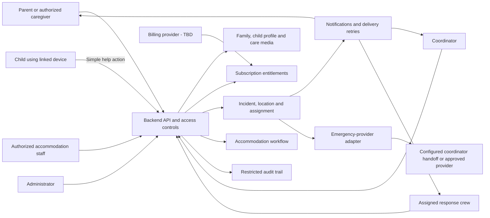
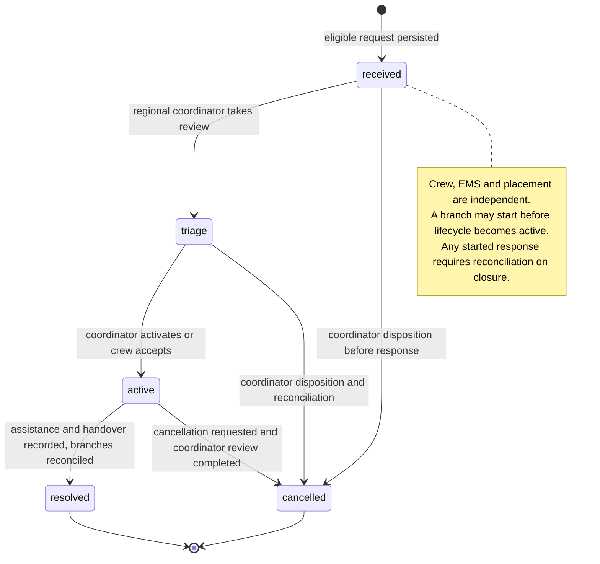
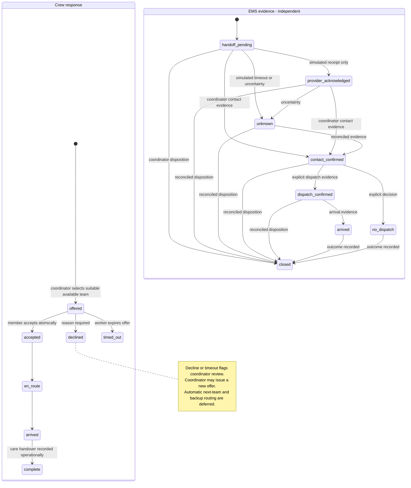
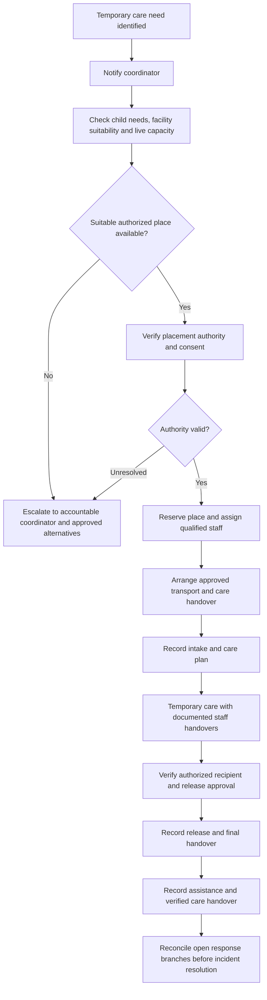

# Life alert — Product requirements baseline

**Version:** 0.2 · **Date:** October 15, 2026 · **Status:** Draft for client review; not client sign-off

**Purpose:** Explain the complete intended service and provide a traceable implementation baseline until client changes arrive. This document authorizes no live emergency operations. The project name is a working name; brand clearance is pending.

## 1. How to read this baseline

| Label | Meaning |
| --- | --- |
| **Confirmed** | Established in the project conversation; still subject to formal client validation. |
| **Proposed** | Recommended design or operating policy requiring client acceptance. |
| **Pending / TBD** | Unknown; must not become an implicit promise or hardcoded assumption. |

Requirements below describe intended behavior. Unless marked Confirmed, detailed technical controls and acceptance criteria are **proposed implementation requirements**, not claims that the client has approved them. All client-approved response intervals, location thresholds, retention periods, capacity rules and service levels are **TBD**. Configurable synthetic development defaults are documented in BACKEND.md and are not operational promises. No deadline in this document is a guaranteed response time.

## 2. Product purpose and boundaries

**Confirmed:** A US-based subscription service supports parents/caregivers and children with disabilities, including autistic children. It combines individualized care information, requests for organizational help, regional response crews and temporary accommodation/care until a parent or authorized caregiver can take over.

Each child has individual communication preferences, strengths, support needs and calming approaches. Diagnosis alone must never determine ability, risk, eligibility or how staff communicate with the child.

A parent can request help. A child can independently initiate help from a previously linked phone/device using a simple accessible control, **without logging in or obtaining parental approval at incident time**. Parent notification, organizational response and configured emergency escalation proceed in parallel. A missing parent response must not hold those processes hostage.

**Clarified:** “24/7 monitoring” refers to the intended care service discussion. Continuous sensor surveillance, automatic health detection, background tracking and guaranteed round-the-clock staffing are not established requirements. Exact coverage hours and the operational service model remain pending.

An active subscription enables paid organizational services. Payment does not guarantee crew availability, EMS dispatch, an ambulance, transport or an accommodation place. Ordinary emergency calling remains separately accessible; it must not require a paid subscription.

### Scope

| In baseline scope | Deferred or unconfirmed |
| --- | --- |
| Family accounts, authorized caregivers, individualized child profiles | Child self-registration: unresolved; use parent-linked access as baseline |
| Secure device linking/revocation and child-initiated help contract | Specific device hardware, wearables, lock-screen controls and supported platforms |
| Audio for child comfort and responder instructions | Continuous surveillance, automated diagnosis or sensor-based detection |
| Subscription entitlements and explicit eligibility outcomes | Pricing, billing vendor, grace periods and cancellation policy |
| Regional crews, coordinator oversight, assignment and escalation | Pilot geography, operating hours, guaranteed availability or arrival times |
| Configurable emergency-provider boundary and coordinator handoff | Selected EMS provider, universal automated 911 integration |
| Accommodation suitability, authorization, intake and release | Licensed care model, facilities, staffing ratios, transport responsibilities |
| Backend contracts, staff/admin access boundaries and audit | Flutter for future Android/iOS; mobile screen design and implementation deferred until client payment and designer delivery |

## 3. Actors and system boundaries



**Proposed:** One modular backend initially, with clear internal boundaries; Django with Django REST Framework is selected; hosting remains undecided. Django and Django REST Framework are confirmed human technical direction. A modular monolith is the selected foundation; microservices are not required. Parent, child and staff interfaces are separate access contexts. A linked child device receives narrowly scoped authority to initiate help for its linked child, not general family access.

| Role | Intended access | Boundary |
| --- | --- | --- |
| Parent / authorized caregiver | Own family, profiles, media, contacts, devices and permitted incident updates | Caregiver authority must be verified; emergency-contact status alone does not confer guardianship or release authority |
| Child through linked device | Help initiation, accessible feedback and permitted comfort media | No incident-time login; no family administration or staff instructions by default |
| Coordinator | Assigned region operations, incident triage, crew offers, placement authorization within authority | Cross-region access and exceptional access require explicit policy and audit |
| Crew member | Assigned incident location and necessary care instructions | No unrestricted browsing of children, billing data or unrelated media |
| Accommodation staff | Authorized placement, relevant care handover, intake and release records | Access tied to duties and active placement |
| Administrator | Roles, configuration, service regions, operational settings | Administration does not automatically confer access to all sensitive child content |

## 4. Family onboarding and readiness

**Confirmed flow:** Parent creates family account → adds child → records individualized care information and emergency contacts → adds comfort/instruction recordings → links device → subscribes → checks service eligibility.

**Proposed requirements:**

| ID | Requirement and acceptance condition |
| --- | --- |
| FAM-01 | Authenticate adult accounts and enforce family ownership on every resource. A user from another family cannot read or modify a guessed child, media, device or incident identifier. |
| FAM-02 | Record each caregiver's relationship, permissions and authorization evidence/status. Inviting a contact must not silently grant child-care or release authority. |
| CARE-01 | Store individual communication methods, sensory/calming preferences, relevant support needs, care instructions, contacts and saved addresses. Required launch fields and eligibility rules are TBD; unknown values must remain distinguishable from “none.” |
| CARE-02 | Allow updates and show who last updated time-sensitive care information. Preserve the care version used during an incident while allowing a clearly labeled latest update. |
| MEDIA-01 | Label each recording by purpose: child comfort, responder instruction, or explicitly both. Apply separate audience permissions even when a file serves both purposes. Offer text alternatives for operational instructions. |
| MEDIA-02 | Secure upload, storage and playback; validate allowed file size/type, scan or otherwise validate uploads, and use expiring authorized access. Removing an audience permission invalidates subsequent access; cached/offline playback policy is TBD. |
| DEV-01 | Link a device to a specific child through an authenticated caregiver flow, issue scoped credentials, and support revocation/replacement. A revoked device cannot create a new accepted paid-service request. |
| DEV-02 | A valid linked device can initiate help without a fresh parent login. Credentials, renewal and loss-of-device handling must be designed before that interface ships. |
| READY-01 | Show subscription, coverage, device linking and profile readiness as separate facts. Do not represent enrollment as guaranteed operational readiness. |

The future child interface must support individually appropriate feedback, large simple actions, alternatives to reading or speaking, assistive technology and error recovery. Supported accessibility targets and device capabilities require client/designer validation. This PRD defines the interaction contract; mobile UI construction is deferred.

## 5. Help request and parallel response

```mermaid
sequenceDiagram
    participant U as Child linked device or parent
    participant B as Backend
    participant P as Parent and configured contacts
    participant O as Organization coordinator
    participant T as Qualified available crew
    participant E as Emergency handoff or provider
    U->>B: Help request, request ID, location context
    B->>B: Validate credential, entitlement and coverage separately
    alt Paid organization request eligible
        B->>B: Persist incident and durable response tasks
        B-->>U: Request received, incident ID
        par Parent branch
            B->>P: Incident notification
            P-->>B: Delivery and acknowledgement tracked separately
        and Organization branch
            B->>O: Operational alert
            B->>T: Assignment offer
            alt Crew accepts within configured interval
                T-->>B: Accept
                B->>B: Confirm assignment atomically
            else Declined, unavailable or timed out
                B->>O: Escalate and try next qualified team
            end
        and Configured emergency branch
            B->>E: Start configured escalation or handoff task
            E-->>B: Contact evidence or provider response
            B->>B: Record actual known EMS state
        end
    else Inactive subscription or unsupported coverage
        B-->>U: Explicit service eligibility result and separate emergency-call access
    end
    Note over B,E: Parent acknowledgement never gates response; provider receipt is not dispatch
```

The configured EMS branch may create an immediate coordinator task or use an approved provider workflow. It must follow the approved operating protocol for the situation and region; this PRD does not prescribe a medical triage algorithm or automatic ambulance request for every tap.

### Incident requirements

| ID | Requirement and acceptance condition |
| --- | --- |
| INC-01 | Persist the incident and durable downstream work before confirming backend receipt. “Request received” means server persistence, not crew acceptance or EMS dispatch. |
| INC-02 | Use idempotency for repeated taps/retries. The same request ID returns the same incident; concurrent attempts cannot assign multiple crews accidentally. A different request ID during an open incident creates an explicit follow-up audit event/review flag, not another incident. The caller receives `followup_requires_review`. Separate simultaneous emergencies require coordinator reconciliation; richer event/location reconciliation is a documented foundation limitation. |
| INC-03 | Parent, organization and configured EMS work proceed independently. With the parent unreachable, crew offers and emergency handoff still run. |
| INC-04 | Distinguish queued notification, delivery, human acknowledgement, assignment offer, accepted assignment and arrival. An SMS delivery receipt must never mark a human as responding. |
| INC-05 | Require crew acceptance and atomic assignment ownership. Declines, timeouts and loss of availability trigger the next configured action and coordinator visibility. All intervals, retry limits and terminal escalation owners are TBD. |
| INC-06 | Provide explicit unassigned/escalated status when nobody accepts. Never show a team as on its way merely because an offer was sent. |
| INC-07 | Authorize cancellation and closure by role, record reasons and reconcile with active crew/EMS/placement work. A child's accidental-tap report must not silently terminate external response. Cancellation protocol and decision authority are pending. |
| INC-08 | Resolve only after documenting outcome, care handover where relevant and disposition of active branches. External cancellation or dispatch uncertainty must remain visible for follow-up. |
| INC-09 | Track independent incidents for different children without cross-family disclosure; record origin, actor, timestamps, relevant care version and all transition evidence. |

### Location and routing

**Confirmed:** Route by the child's/incident's location, never the developer's location in Nigeria or a parent's remote location by default.

**Proposed routing order:** Receive coordinates with source, accuracy and capture time → evaluate configured freshness/accuracy thresholds → identify service area → filter by qualifications, shift availability, availability and care suitability → rank by estimated travel time where supported → offer assignment and await acceptance. Straight-line distance is a labeled fallback, not an arrival guarantee.

**LOC-01:** Stale, inaccurate, denied or missing coordinates remain explicitly labeled. A saved address is a **saved-address fallback**, not a live fix. Request verification from a capable person without making parent response a prerequisite for all action. If location cannot be established, alert the coordinator to resolve it; never fabricate coordinates or dispatch to an unlabeled guess.

**LOC-02:** Re-evaluate a meaningful location change, notify current responders and preserve assignment control. Avoid duplicate dispatch. Service boundaries, location precision thresholds, map vendor and travel-time capability are configurable pending decisions.

### Separate state dimensions

The incident coordinates work; crew, notifications, EMS and accommodation each own separate state. An incident is not a single “dispatched” flag.





These diagrams show core paths; authorized overrides, reassignments and exceptional outcomes require recorded reasons. EMS states do not advance automatically with crew states. “Contact confirmed” is not “dispatch confirmed”; dispatch evidence must identify its source and time. Arrival is separately recorded. Provider-specific intermediate states must map conservatively to these meanings.

## 6. Subscription and service eligibility

**Confirmed:** Paid organization features are available to active subscribers. Connectivity failure and being outside coverage do not cancel an otherwise active subscription. There is no agreed blanket free organization-service policy.

| Situation | Required intended behavior |
| --- | --- |
| Active subscription, eligible location and request | Accept paid organization request; operational availability is separately evaluated and shown |
| Expired/inactive subscription, new request | Do not grant paid service; explain entitlement result and retain separate ordinary emergency-call access |
| Active subscription, outside service area | Preserve subscription state; show unsupported coverage, provide separate emergency-call access, and apply only an approved out-of-area policy |
| No connectivity | Show that organizational delivery is unconfirmed; do not infer subscription expiry or “help is coming” |
| Billing state temporarily unknown | Show pending verification and route to configured operational review; fail-safe entitlement policy is a launch decision, not an automatic grant |
| Subscription expires during an accepted incident | **Human-confirmed baseline, pending formal client validation:** continue accepted response through resolution. New paid incidents require current entitlement. Accepted care is not automatically terminated by expiry. |

**SUB-01:** Enforce entitlements on the server. Record entitlement evidence and effective time at request acceptance. Handle delayed, duplicated and out-of-order billing events idempotently; reconcile with billing authority. Provider, plans, paid feature list, refund/cancellation rules, grace periods and timezone/effective-time rules are pending.

**SUB-02:** Keep emergency-call access independent of billing and organizational coverage. It opens the supported device calling pathway; the product must not claim that selecting it itself connects a call or dispatches EMS. Unsupported device/calling capabilities need explicit handling.

## 7. Temporary accommodation and care

**Confirmed:** Organization receives the need for temporary care; a coordinator checks suitability and capacity, authorizes placement and assigns staff. Accommodation is temporary support until parental or authorized caregiver support is available, subject to the organization's actual operating authority and capabilities.



| ID | Requirement and acceptance condition |
| --- | --- |
| ACC-01 | Maintain facilities/places, service eligibility, capacity and suitability attributes. An active subscription alone must never create a confirmed placement. |
| ACC-02 | Reserve capacity atomically; concurrent authorizations cannot allocate the same final place. Expiry/release of reservations follows a configurable policy. |
| ACC-03 | Record who authorized placement, applicable authority/consent, validity and any exception pathway approved by the organization. Unresolved authority requires escalation; software cannot invent consent. |
| ACC-04 | Document assigned staff, transport responsibility, arrival/intake time, relevant care information, belongings and authorized care handover. Medication or clinical activities are only in scope if legally and operationally approved. |
| ACC-05 | Maintain accountable staff ownership through shift changes. Record care events needed for the approved model without collecting unnecessary sensitive detail. |
| ACC-06 | Verify release recipient identity and authority, capture release approval/time and handover outcome. Being listed as an emergency contact alone is insufficient authority to collect a child. |
| ACC-07 | No suitable capacity triggers visible coordinator escalation and approved alternatives, not a fabricated booking. Maximum stay, overnight support, fees, staffing ratios, transport and incident/placement closure criteria are TBD. |

## 8. Reliability, privacy and emergency-provider boundary

**Proposed reliability requirements:** Durable event delivery, bounded retries with backoff, idempotent processing and observable failure queues. Record delivery/provider attempt IDs, evidence, timestamps and responsible escalation owner. A provider timeout is **unknown**, not success or confirmed failure. Reconcile before any retry that could create duplicate external action. Manual actions must record operator and evidence. Operational dashboards must show overdue/unowned work; numerical availability, recovery and response targets need an approved staffing and infrastructure plan.

**Offline behavior:** A future device interface distinguishes local action from server receipt. Local comfort audio, if approved and available, must not imply an alert was delivered. Show separate emergency-call access and available contact options appropriate to device capabilities. Queued requests retain original timestamps and idempotency keys; reconnection must trigger an age/relevance review policy rather than silently launching a stale emergency response. Thresholds and review ownership are pending.

**Proposed security requirements:**

- Encrypt sensitive data in transit and at rest; protect credentials and separate environment secrets. Require appropriate staff authentication, with MFA proposed for privileged/staff access.
- Apply family, region, assignment and purpose-based permissions to profiles, precise location, recordings and care records. Limit staff access after assignment/placement ends according to an approved retention/access policy.
- Audit sensitive reads, downloads, role changes, device links/revocations, entitlement overrides, assignments, provider evidence, care authorization and release. Protect logs from modification; avoid embedding recordings, full care details, credentials or unnecessary location data in routine logs.
- Define consent, data export/correction, deletion, retention, backups, recovery, incident response and exceptional access before launch. Deletion requests must follow reviewed retention/legal-hold rules and include cached media/backups as applicable.
- Determine applicable US federal/state privacy, child protection, care licensing, accessibility and emergency-operation obligations through qualified review. **Do not claim HIPAA or COPPA applicability or compliance without that review.** Jurisdiction, age range, organizational role and actual data practices remain unknown.

### EMS integration posture

**Proposed first implementation:** An emergency-provider adapter with simulated/sandbox outcomes and an explicit coordinator-led handoff workflow. Provider identity, approved geography, partner agreement, authority, contact method, dispatch evidence and escalation protocol are **live-launch blockers**. A coordinator calling from elsewhere needs an approved method for reaching the authority serving the incident location.

RapidSOS is a **candidate only**, not a selected vendor. Its public materials offer partner/developer onboarding and an emergency-workflow reference; access and suitability must be confirmed directly. Public 911 guidance explains that capabilities vary and that emergency location and caller information matter. These sources do not establish Life alert's integration rights or guarantee dispatch:

- [National 911 Program: frequently asked questions](https://www.911.gov/calling-911/frequently-asked-questions/) — location, local capability and remote-jurisdiction considerations.
- [RapidSOS developer portal request](https://info.rapidsos.com/developer-portal-request) — candidate onboarding entry point.
- [RapidSOS emergency-workflow reference](https://developer.rapidsos.com/tech_partners/default/emergency-workflow) — candidate workflow reference; detailed access/contract must be confirmed.

Sources checked October 15, 2026. The RapidSOS workflow page did not expose detailed implementation content in this review; no endpoint or dispatch guarantee is inferred. Development and automated tests must use simulated providers, isolated notifications and test billing; **do not trigger real emergency services**.

## 9. Backend boundaries and core records

| Module | Responsibility / principal records |
| --- | --- |
| Accounts and access | Users, families, caregiver memberships, roles and authority records |
| Child profiles | Child, individualized support plan, contacts, saved addresses and care versions |
| Linked devices | Device links, scoped credentials, revocation and last verified capability |
| Care media | Audio metadata, purpose/audiences, protected media references and text alternatives |
| Subscriptions | Plans/entitlements, billing events and effective eligibility evidence |
| Regions and crews | Service areas/hours, crew qualifications, availability and location |
| Incidents and escalation | Request IDs, location observations, incident events, offers, assignments and escalations |
| Emergency-provider adapter | Provider operations, contact/dispatch evidence, reconciliation and manual handoffs |
| Notifications | Recipient/channel preferences, durable jobs, attempts, receipts and acknowledgements |
| Accommodation | Facilities, places, reservations, authority/consent, staff, intake, handovers and release |
| Coordinator/admin API and audit | Operational controls, configuration versions, authorized overrides and audit events |

**Proposed invariants:** One request ID creates at most one incident; one active crew assignment per response role unless explicitly coordinated; capacity cannot be double allocated; no cross-family access; no dispatch-confirmed status without evidence. Incident creation uses server timestamps alongside device capture timestamps. External integrations operate through replaceable interfaces. Database, media storage, queue, authentication, billing, notification and mapping vendors are undecided.

## 10. Delivery phases and release gates

| Phase | Deliverable | Exit condition |
| --- | --- | --- |
| 0 — Baseline review | This PRD, decision log, service boundaries and actor definitions | Client reviews confirmed/proposed/pending items; owners assigned to decisions |
| 1 — Backend design | Use selected Django stack; choose hosting approach; define schema, API contracts, state transitions, authorization and adapter interfaces | Technical design review and resolution of immediate coding blockers; no live operational claims |
| 2 — Backend core | Accounts, profiles/media, devices, entitlements, incidents, simulated notifications/provider, assignment and audit | Automated acceptance scenarios pass with synthetic data; mobile interfaces remain deferred |
| 3 — Care operations | Staff/coordinator capabilities and accommodation workflows; failure/recovery exercises | Approved authority, staffing, capacity and handover rules reflected in contracts and runbooks |
| 4 — Interface and integration | Flutter UI only after client payment and designer screens; approved billing/notification/EMS integration | Accessibility/device validation and provider sandbox verification; operational training |
| 5 — Limited pilot | Approved geography, staffing and monitored rollout | All launch blockers resolved, documented fallback and response ownership, client go-live approval |

These phases describe sequencing, not delivery dates. Backend-first is the working intention. The next authorized deliverable is a bounded backend foundation; it does not constitute an operational emergency service.

## 11. Acceptance scenarios for implementation

Use controlled synthetic accounts, locations and provider simulations. These tests are an implementation checklist, not tests already executed.

| ID | Given / when | Expected observable outcome |
| --- | --- | --- |
| AT-01 | Active eligible child on linked device taps help while parent is unreachable | One incident persists; parent, coordinator/crew and configured EMS tasks start independently; no parent-approval wait |
| AT-02 | Device repeats same tap/request during a timeout | Same incident ID and logical side effects; no duplicate crew assignment or external emergency request |
| AT-03 | Device has no connectivity | Clear unconfirmed delivery; no claim of organization receipt or arrival; separate emergency-call path remains accessible where supported |
| AT-04 | Coordinates are stale or missing; saved address exists | Age/accuracy or missing state shown; saved-address fallback labeled; coordinator verification/escalation task exists |
| AT-05 | Child is in a different region from parent | Assignment uses incident location, qualified available teams and that region's configuration |
| AT-06 | No crew acknowledges or accepts | Configured timers/retries expire, accountable coordinator escalation remains visible; no false assigned/on-the-way state |
| AT-07 | Two crews accept concurrently | At most one ownership transition succeeds; other crew receives updated status; both attempts auditable |
| AT-08 | Subscription is expired before a new request | Paid service denied with explicit reason; emergency-call access remains; no fabricated accepted incident |
| AT-09 | Active subscriber loses coverage or network | Subscription remains active; coverage/connectivity outcome shown independently |
| AT-10 | Entitlement expires mid-incident | Test the implemented human-confirmed continuation baseline now: accepted care continues; new paid requests after expiry are restricted. Formal client validation remains a launch gate. |
| AT-11 | Provider acknowledges receipt, then times out | Receipt/contact/dispatch remain distinct; unknown outcome escalates for reconciliation; no ambulance-dispatched message |
| AT-12 | Verified dispatch evidence arrives twice or out of order | Evidence recorded idempotently; status does not regress incorrectly; crew state remains independent |
| AT-13 | Unrelated parent or unassigned crew requests child/media/location | Access denied and audited as appropriate; no sensitive resource metadata leaked |
| AT-14 | Recording is comfort-only; staff requests responder instructions | Audience rules enforced; a child's comfort access does not expose responder-only instructions |
| AT-15 | Device revoked before help request | Scoped credential rejected; parent/coordinator recovery and separate ordinary emergency access follow approved policy |
| AT-16 | Final accommodation place receives two reservation attempts | One succeeds; other escalates for alternatives; no false capacity confirmation |
| AT-17 | Listed contact without release authority attempts collection | Release blocked pending authorized verification; accountable staff alerted and action audited |
| AT-18 | Parent cancels while EMS outcome is unknown | Cancellation review and external reconciliation remain visible; local cancellation does not assert external response was cancelled |
| AT-19 | Service restarts after accepting incident but before notifications | Durable work resumes without duplicate logical incident or lost escalation tasks |
| AT-20 | Device reconnects with an old queued request | Original time retained; approved relevance/review policy applied before delayed operational escalation |

## 12. Decisions and questions before building

### Immediate design/coding blockers

These do not block reviewing this PRD. Human authorization selected sensible foundation defaults; remaining business decisions stay configurable:

1. **Resolved for foundation:** Django and Django REST Framework modular backend; local SQLite with PostgreSQL-ready models and transactional services. Production hosting/database operations remain pending.
2. **Foundation defaults selected:** guardian household management, scoped/revocable child-device credentials, regional coordinator access and assigned-responder access. See `BACKEND.md` for implemented state transitions and limitations; client operational authority remains pending.
3. Define entitlement source and paid feature boundary before entitlement enforcement; stub vendors while contracts are under review.
4. Agree coordinator/EMS adapter semantics and state evidence before implementation. A real provider is unnecessary for simulated contracts, but unknowns must stay explicit.

### Configurable details that need not block baseline design

Regions, crew lists, provider identifiers, notification channels, location thresholds, offer timeouts, retry settings and facility inventories can be modeled as configuration. Avoid hardcoding invented values. Production values and accountable owners must be approved before live use. Vendor selection may be deferred behind adapters, while framework/runtime selection is needed before coding.

### Client questions and launch blockers

| Decision / concise client question | Why it matters | Owner / deadline |
| --- | --- | --- |
| What entity operates the service, and under what care/response authority? Is it care coordination, direct care, transport, licensed accommodation or a combination? | Defines permissible operations and required review | Client / before live operations |
| Which states/areas and coverage hours form the pilot? | Defines routing, staffing, emergency jurisdictions and user expectations | Client operations / before pilot configuration |
| Who staffs coordination and crews, with what qualifications, and who owns unanswered alerts/escalations? | Every incident needs accountable human coverage and approved timeouts | Operations / before live pilot |
| Who may authorize placement, consent, transport, care and release? How is authority verified when parents are unavailable? | Prevents unauthorized care or release | Client and qualified reviewers / before accommodation launch |
| What ages/support needs are eligible, and what care cannot be provided? | Defines honest enrollment and suitability rules | Client care lead / before enrollment |
| Which phones/devices and notification channels are supported, and what accessibility needs must be accommodated? | Defines linked-device contract and validated feedback/delivery | Client and designer / before interface integration |
| What EMS arrangement serves each region, and who confirms contact/dispatch and reconciles uncertain outcomes? | Establishes real provider authority and escalation protocol | Client emergency operations / before live emergency handoff |
| What are prices, paid features, billing and grace/cancellation/refund rules? Validate the human-confirmed accepted-incident continuation baseline. | Prevents entitlement and care-continuity assumptions | Client commercial and operations / before paid launch |
| What data/recordings may each role access, how long are they retained, and which laws/consent rules apply? | Defines privacy, deletion, child protection and care obligations | Client and qualified legal/privacy reviewers / before personal-data launch |
| Which facilities, staffing ratios, capacity checks, transport and maximum stays are authorized? | Determines feasible temporary care rather than an implied housing guarantee | Client care operations / before accommodation launch |

**Launch gate:** An unresolved critical authority, staffing, EMS, privacy, entitlement, handover or recovery decision prevents the affected live service from launching. A sandbox/backend design can proceed with explicit placeholders and simulated integrations. The client must approve service claims, escalation runbooks, operational targets and failure handling before a pilot.

## 13. Review, metrics and change control

**Proposed success measures:** Time from server receipt to coordinator acknowledgement, crew offer/acceptance/arrival, configured EMS contact and evidence of dispatch; unassigned/escalated incident count; notification failure rate; duplicate action rate; location verification rate; accommodation refusal/capacity reasons; completed authorized handovers. Report distributions and unknown/missing evidence separately. Numeric targets and measurement access are TBD; no metric implies a guarantee.

Use requirement IDs above in implementation tasks and acceptance checks. Treat this file as the baseline until reviewed changes are recorded.

For every client change, record: date/requestor, requirement IDs affected, reason, before/after behavior, privacy/operational impact, interface/data migration impact, acceptance updates, approving owner and intended release. Update diagrams and requirements together. Do not turn a Pending item into Confirmed without recording the source of approval. Revalidate provider assumptions and operating geography when they change.

| Version | Date | Change | Approval |
| --- | --- | --- | --- |
| 0.1 | 2026-10-15 | Initial diagrammatic baseline from project discussion | Pending client review |
| 0.2 | 2026-10-15 | Human selected Django and authorized backend foundation; continuity baseline human-confirmed; formal client validation pending | Technical direction authorized; formal client validation pending |

**Next review outcome:** Client confirms or corrects the operating model and decision register; developer uses the selected Django foundation; implementation proceeds against this labeled baseline, with mobile design deferred as agreed.

## 14. Authorized foundation decisions (October 15, 2026)

The human authorized implementation now, using Django, without waiting for client geography, staffing, eligibility, prices or partner details. These remain configuration/launch decisions. Frontend directories document API consumers only; no mobile interface is implemented.

The canonical foundation incident lifecycle is **received → triage → active → resolved**, with **received/triage → cancelled** before response starts. Received means an eligible request was durably accepted; triage means a coordinator owns review; active means a coordinator has activated the response or a crew accepted its offer; individual response branches may start earlier and are tracked independently. Resolved records outcome and completion of dependent work; cancelled retains the incident and audit. Once response has started (including assignment/EMS/placement activity), cancellation requires a coordinator request/review with explicit branch reconciliation before approval. Cancellation is never record deletion. Crew, notification, EMS and placement states remain independent. See `BACKEND.md` for exact implemented transitions, the safe simulation boundary and outstanding production gates.

Paid new incidents require entitlement at atomic acceptance. Repeated request IDs replay the original accepted incident, including after expiry; they do not create another incident. A second request ID for the same child's still-open incident returns that incident with an explicit `followup_requires_review` result, sets a review flag and records an audit event, while requiring entitlement for the new request. It must not imply the second emergency has been independently dispatched. This foundation supports one open incident per child; reconciling genuinely separate simultaneous events needs coordinator handling and a later expanded workflow. The continuation policy is human-confirmed and implemented as the default, pending formal client validation. A future reviewed configuration override may flag policy review; it never automatically abandons care. The default continues accepted incidents.

### Closure without temporary care

Accommodation is optional, not a prerequisite to resolution. The coordinator records the assistance actually provided, the verified parent/authorized-caregiver handover or other approved disposition, actual known EMS outcome (including no dispatch or uncertain outcome), and follow-up ownership. They reconcile outstanding crew, EMS and placement work before resolving. “No temporary care needed” alone never automatically closes an incident. The initial API stores a required outcome narrative and coordinator reconciliation assertion; structured handover identity/evidence and follow-up tasks remain implementation work before production.

### Foundation scope note

Flutter is the selected future mobile technology for Android/iOS. No mobile screens are implemented in this foundation. The implemented backend is described in [BACKEND.md](BACKEND.md); product diagrams describe both implemented core behavior and explicitly deferred operating workflows. For exact API states and supported transitions, BACKEND.md is authoritative for this version.

### Crew decline and coordinator escalation

A qualified crew may still decline because it has become busy, lost connectivity, has a vehicle/equipment failure or discovers a support mismatch. On-duty status, eligibility, current availability and coordinator suitability review must precede offers. A decline requires a reason; absence of acknowledgement is a timeout, not acceptance.

The **coordinator is an accountable human in the operating organization**, authorized for the incident region. Intended operational fallback: alert that coordinator while offering the next eligible available crew; if the coordinator does not acknowledge within the configured interval, escalate to the configured backup/supervisor. Keep the incident open and visibly unassigned until an actual acceptance. EMS runs independently. The client must supply staffing, ownership, qualification rules and all timer values.

**Foundation limitation:** it supports manual coordinator offers, decline reasons, expiry of unaccepted offers and a durable review flag. Automatic next-team selection, coordinator acknowledgement timers, backup/supervisor routing and live notification retries are not implemented. Running the local worker is required to expire offers. No live staffing or arrival guarantee is implied.

### Coordinator responsibility — human-confirmed

After escalation, the regional coordinator must actively work on a solution for the child: acknowledge incident ownership, arrange appropriate response, document actions and next steps, and follow through to verified care handover/resolution. An alert being sent or acknowledged does not itself establish ownership or resolution. The foundation records explicit coordinator ownership and progress notes; the backup/supervisor chain remains a proposed configurable safeguard pending operating arrangements.

### Reassuring status language and proposed mobilization target

Child and parent feedback must be calm and truthful: “Your request was received” follows durable receipt; “We are contacting a response team” follows an actual offer; “A response team has accepted your request” follows acceptance; “Your response team is on the way” requires confirmed en-route evidence. Acknowledgement by a notification or emergency provider does not establish any of those crew milestones. Follow-up requests receive an explicit review message rather than implying a separate response has been dispatched.

The human proposed **5–10 minutes** as an organizational mobilization target. This is **proposed**, pending client staffing/coverage validation and a precise milestone definition (for example assignment versus en-route). It is not a guaranteed arrival time, approved service level, hardcoded timeout or promise shown before crew acceptance. Measure receipt-to-acknowledgement, ownership, assignment, en-route and arrival separately; future overdue escalation must use approved configurable thresholds.
